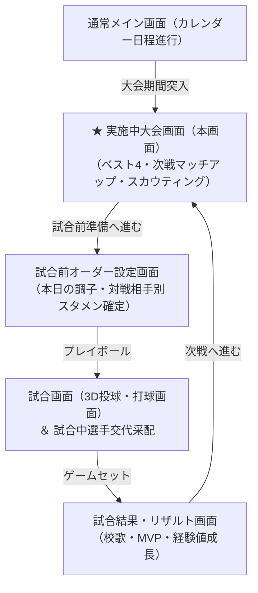
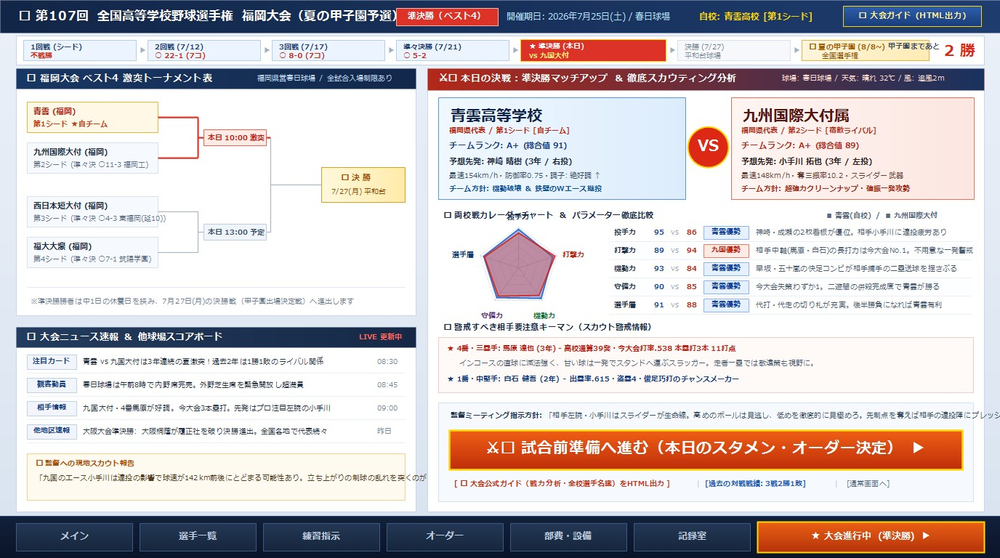
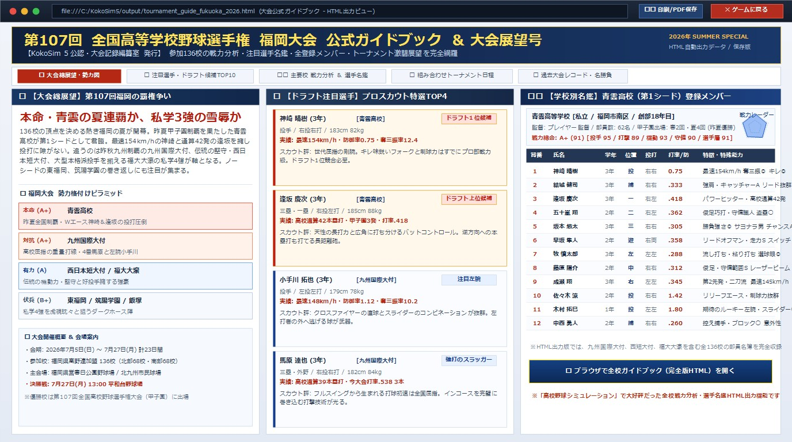

# 高校野球シミュレーション5（KokoSim 5）画面仕様書：実施中大会画面

**文書バージョン**: 1.0.0  
**作成日**: 2026年10月20日  
**ステータス**: 初版確定ドラフト  
**対象画面**: 実施中大会画面（アクティブ・トーナメント・ダッシュボード）

---

## 1. 画面概要・コンセプト

「実施中大会画面」は、春季都道府県大会、夏の地方選手権予選、秋季大会、そして甲子園本大会の期間中に、通常の練習マネジメント画面から切り替わって表示される**「大会進行専用のベースキャンプ画面」**です。

プレイヤー（監督）は、自チームの勝ち上がり状況や甲子園までの残り勝利数を確認し、他球場のリアルタイム速報を把握しながら、**本日の対戦相手（ライバル校）の徹底スカウティング情報（予想先発、戦力パラメーター比較、要注意スラッガー）を分析**して、試合前の最終スタメン決定へ臨みます。



---

## 2. 画面レイアウト構成（1376 × 768 px HD）



画面は以下の5つのエリアで構成されます。

```
+----------------------------------------------------------------------------------------------------+
| 1. 上部ヘッダーバー: 大会名 / ステージバッジ[準決勝] / 日程・球場 / 自チーム情報 / 気象情報         |
+----------------------------------------------------------------------------------------------------+
| 2. 大会ロード進捗バー: [1回戦] ➡ [2回戦] ➡ [3回戦] ➡ [準々決] ➡ [★準決勝] ➡ [決勝] ➡ [甲子園]     |
|    ※右端に「甲子園まであと 2勝」の巨大カウントダウン表示                                          |
+----------------------------------------------------------------------------------------------------+
| 3. メインコンテンツエリア (2ペイン構成)                                                            |
|  +---------------------------------------------+  +----------------------------------------------+  |
|  | 【左ペイン】(W: 550)                        |  | 【右ペイン】(W: 766)                         |  |
|  | ① 上部: ベスト4 激突トーナメント表          |  | 本日の決戦：次戦マッチアップ ＆ スカウティング |  |
|  |    - 青雲 vs 九州国際大付 (本日10:00 激突)  |  |  - 巨大対戦カード (青雲 A+ vs 九国大付 A+)   |  |
|  |    - 西短大付 vs 福大大濠 (本日13:00 予定)  |  |  - 予想先発 (神崎 154km/h vs 小手川 148km/h) |  |
|  |    - 決勝戦 (7/27 平和台球場) への合流線    |  |  - 戦力パラメーター徹底比較 (投・打・走・守) |  |
|  |                                             |  |  - 警戒すべき相手要注意キーマン (4番馬原等)  |  |
|  | ② 下部: 大会ニュース速報 ＆ 他球場スコア    |  |  - 監督ミーティング指示方針                  |  |
|  |    - LIVE更新ニュース (観客満員、他地区情報)|  |  - 【超大型ボタン】                          |  |
|  |    - 監督への現地スカウト報告メモ           |  |    [⚔️ 試合前準備（スタメン決定）へ進む ▶]   |  |
|  +---------------------------------------------+  +----------------------------------------------+  |
+----------------------------------------------------------------------------------------------------+
| 4. ボトムナビゲーションバー: [メイン] [選手一覧] [練習指示] [オーダー] [部費・設備] [記録室]       |
|    右端アクション: [★ 大会進行中 (準決勝) ▶] (オレンジ発光ハイライト)                              |
+----------------------------------------------------------------------------------------------------+
```

---

## 3. 各機能エリアの詳細仕様

### 3.1 上部ヘッダー ＆ 大会ロード進捗バー
- **大会基本情報**:
  - 大会正式名称: `第107回 全国高等学校野球選手権 福岡大会（夏の甲子園予選）`
  - 現在の回戦バッジ: `準決勝（ベスト4）`（赤色バッジで現在位置を明示）
  - 期日・球場: `2026年7月25日(土) / 福岡県営春日公園野球場`
- **大会ロード進捗バー**:
  - 初戦から甲子園全国制覇までの勝ち上がりロードをステップ表示。
  - `[1回戦 (不戦勝)]` ➡ `[2回戦 ○22-1]` ➡ `[3回戦 ○8-0]` ➡ `[準々決勝 ○5-2]` ➡ **`[★ 準決勝 (本日) vs 九国大付]`** ➡ `[決勝 7/27]` ➡ `[🏆 夏の甲子園 8/8~]`
  - 右端に**「甲子園まであと 2勝」**を赤文字で大きく表示し、プレイヤーのモチベーションを刺激。

---

### 3.2 左ペイン：ベスト4 トーナメント表 ＆ 大会ニュース速報

#### ① ベスト4 リアルタイムトーナメント表
- 現在残っている4強（すべて第1〜第4シードの強豪校）のトーナメントツリーを直感的に表示。
- **準決勝 第1試合（10:00開始）**:
  - **青雲高校（第1シード・自校）** vs **九州国際大付（第2シード）**
  - 赤い太線（2.2px）で本日の対戦カードをハイライトし、`[本日 10:00 激突]` バッジを点灯。
- **準決勝 第2試合（13:00開始予定）**:
  - **西日本短大付（第3シード）** vs **福大大濠（第4シード）**
- **決勝戦（7月27日 13:00 平和台球場）**:
  - 優勝旗・甲子園切符をかけた最終決戦の舞台と日程を明示。中1日の休養日があることも注記。

#### ② 大会ニュース速報 ＆ 現地スカウト報告
- **LIVE更新ニュースフラッシュ**:
  - 注目カードの因縁（「青雲 vs 九国大付は3年連続の夏激突！過去2年は1勝1敗」）。
  - 球場観客動員情報（「午前8時で内野席完売、外野芝生席を緊急開放」）。
  - ライバル校の直近情報（「4番馬原が3試合連続弾、先発はプロ注目左腕の小手川」）。
  - 全国の甲子園速報（「大阪大会で大阪桐蔭が決勝進出」など全国の情勢）。
- **現地スカウトからの特報メモ**:
  - 「九国のエース小手川は連投の影響で球速が142km前後にとどまる可能性あり。立ち上がりの制球の乱れを突くのが勝機です。」といった、采配のヒントになる生の情報を提供。

---

### 3.3 右ペイン：本日の決戦マッチアップ ＆ 徹底スカウティング分析

#### ① 巨大マッチアップカード（青雲 vs 九州国際大付）
左右に対比された迫力のチームカードと中央の燃える「VS」エンブレム。
- **青雲高校（自チーム）**:
  - チームランク: **A+（総合値 91）**
  - 予想先発: **神崎 晴樹（3年 / 右投）** - 最速154km/h・防御率0.75・**調子: 絶好調 ↑**
  - チーム方針: 機動破壊 ＆ 鉄壁のWエース継投
- **九州国際大付属（相手校）**:
  - チームランク: **A+（総合値 89）**
  - 予想先発: **小手川 拓也（3年 / 左投）** - 最速148km/h・奪三振率10.2・切れ味鋭いスライダー武器
  - チーム方針: 超強力クリーンナップ・強振一発攻勢

#### ② 戦力レーダーチャート ＆ パラメーター徹底比較
左側に**青（自校・青雲）と赤（相手校・九国大付）が重なり合う半透明5角形レーダーチャート**、右側に数値比較・優勢分析テーブルを配置。
1. **戦力レーダーチャート（5軸）**:
   - 投手力（上）、打撃力（右上）、機動力（右下）、守備力（左下）、選手層（左上）の5軸グリッド。
   - 青雲（青ポリゴン）が投手・機動で突き出し、九国大付（赤ポリゴン）が打撃で突出する戦力バランスの差を直感的に可視化。
2. **パラメーター比較テーブル ＆ 優勢判定**:
   - **投手力（青雲 95 vs 九国 86）** ➡ `[青雲優勢]`: 神崎・成瀬の2枚看板が優勢。相手はエース小手川の連投疲労あり。
   - **打撃力（青雲 89 vs 九国 94）** ➡ `[九国優勢]`: 相手中軸の長打力は今大会No.1。不用意な一発は厳禁。
   - **機動力（青雲 93 vs 九国 84）** ➡ `[青雲優勢]`: 早坂・五十嵐の快足コンビが相手捕手の送球を揺さぶる。
   - **守備力（青雲 90 vs 九国 85）** ➡ `[青雲優勢]`: 失策わずか1。二遊間の併殺完成度で青雲が勝る。
   - **選手層（青雲 91 vs 九国 88）** ➡ `[青雲優勢]`: 代打・代走陣が充実。終盤の勝負所で青雲有利。

#### ③ 警戒すべき相手要注意キーマン（スカウトレポート）
- **4番・三塁手: 馬原 達也（3年）**: 高校通算39本塁打、今大会打率.538、3本塁打11打点。内角直球に滅法強いスラッガー。走者一塁では敬遠策も選択肢。
- **1番・中堅手: 白石 健吾（2年）**: 出塁率.615、盗塁4。俊足巧打のリードオフマン。

#### ④ 監督ミーティング指示方針
- 監督から選手たちへの試合前訓示テキスト：
  「相手左腕・小手川はスライダーが生命線。高めのボールは見逃し、低めを徹底的に見極めろ。先制点を奪えば相手の連投陣にプレッシャーがかかる！」

#### ⑤ 決定アクションボタン ＆ 大会ガイド出力
- **超大型ボタン**: `[ ⚔️ 試合前準備へ進む（本日のスタメン・オーダー決定） ▶ ]`
  - クリックすると、当日の部員の調子確認やスタメン組み替えを行う「試合前オーダー画面」へ遷移。
- **ヘッダーボタン ＆ サブリンク**:
  - `[ 📖 大会ガイド (HTML出力) ]`（画面右上ヘッダー）
  - `[ 📖 大会公式ガイド（戦力分析・全校選手名鑑）をHTML出力 ]`（右ペイン下部リンク）
  - `[ 過去の対戦戦績: 3戦2勝1敗 ]`
  - `[ 通常画面へ ]`

---

### 3.4 「大会ガイド」HTML出力機能（大好評機能の継承）

プレイヤーが大会の全体像、全参加校の戦力分析、注目選手、トーナメント組み合わせをじっくり読み込めるように、**ブラウザで閲覧可能な独立したHTML形式の公式パンフレット（ガイドブック）を出力・即座にオープン**する機能です。過去作『高校野球シミュレーション』でユーザーから絶大な支持を集めた名物機能をKokoSim 5向けに完全刷新して搭載します。


※実際のブラウザ出力サンプル: [tournament_guide_sample.html](./tournament_guide_sample.html)

#### 大会ガイドHTMLの主なコンテンツ構成:
1. **マストヘッド・表紙ヘッダー**:
   - 大会名、会期、参加136校、主会場、福岡県高野連＆KokoSim 5記録編纂室公認クレジット。
   - `[🖨️ ガイドを印刷 / PDF保存]` ボタン完備（A4印刷スタイルシート適用）。
2. **大会総展望 ＆ 勢力格付けピラミッド**:
   - 特集コラム: 「本命・青雲の夏連覇か、私学3強の雪辱か」。
   - 勢力格付けカード（本命: 青雲高校、対抗: 九州国際大付、有力: 西短大付/福大大濠、伏兵: 東福岡/筑陽学園/飯塚）。
3. **ドラフト注目選手・トッププロスペクト名鑑**:
   - 神崎晴樹（154km/h本格派）、逢坂慶次（通算42発スラッガー）、小手川拓也（148km/h左腕）、馬原達也（強打の主砲）などの選手カード（顔写真、投打、身長体重、公式戦成績、プロスカウト評）。
4. **全校戦力分析 ＆ 登録部員20名名鑑テーブル**:
   - 学校紹介（所在地、部員数、甲子園出場歴、総合ランク・5軸ステータス）。
   - ベンチ入り登録メンバー20名の完全名鑑（背番号、氏名、学年、守備位置、投打、身長体重、打率/防御率、特徴・特殊能力）。
5. **組み合わせ日程 ＆ 球場アクセス案内**:
   - 春日球場、北九州市民球場、平和台球場での開催スケジュール。

---

## 4. データ構造設計（スキーマ定義例）

```typescript
// 実施中大会データ
interface ActiveTournamentData {
  tournamentId: string;
  tournamentName: string;          // "第107回 全国高等学校野球選手権 福岡大会"
  currentRound: 'r1' | 'r2' | 'r3' | 'qf' | 'sf' | 'final'; // 'sf' (準決勝)
  roundDisplayName: string;        // "準決勝（ベスト4）"
  winsToKoshien: number;           // 甲子園まであと 2勝
  matchDate: string;               // "2026-07-25"
  stadium: string;                 // "福岡県営春日公園野球場"
  weather: 'clear' | 'sunny' | 'cloudy' | 'rainy';
  temperature: number;             // 32
  wind: string;                    // "南風 2m"
  
  // 自チーム情報
  myTeam: {
    teamId: string;
    teamName: string;
    seedBadge: string;             // "第1シード"
    rank: 'S' | 'A+' | 'A' | 'B+' | 'B';
    totalPower: number;            // 91
    probablePitcher: ProbablePitcherInfo;
  };

  // 相手チーム情報（スカウティング）
  opponentTeam: {
    teamId: string;
    teamName: string;
    seedBadge: string;             // "第2シード"
    rank: 'S' | 'A+' | 'A' | 'B+' | 'B';
    totalPower: number;            // 89
    probablePitcher: ProbablePitcherInfo;
    keyPlayers: KeyPlayerScout[];
    pastRecord: { wins: number; losses: number; ties: number };
  };

  // 戦力比較データ
  statComparison: {
    category: string;              // "投手力"
    myValue: number;               // 95
    oppValue: number;              // 86
    analysisComment: string;
  }[];

  // 他球場・大会ニュース
  newsList: {
    tag: string;
    headline: string;
    time: string;
  }[];
  scoutTip: string;                // 現地スカウトの耳寄り情報
}

interface ProbablePitcherInfo {
  playerName: string;
  grade: number;                   // 3年
  throwingHand: 'right' | 'left';
  maxSpeed: number;                // 154
  era: number;                     // 0.75
  condition: 'best' | 'good' | 'normal' | 'bad' | 'terrible';
  featureText: string;
}

interface KeyPlayerScout {
  orderNum: number;
  position: string;
  playerName: string;
  grade: number;
  statsSummary: string;
  warningNote: string;
}
```
