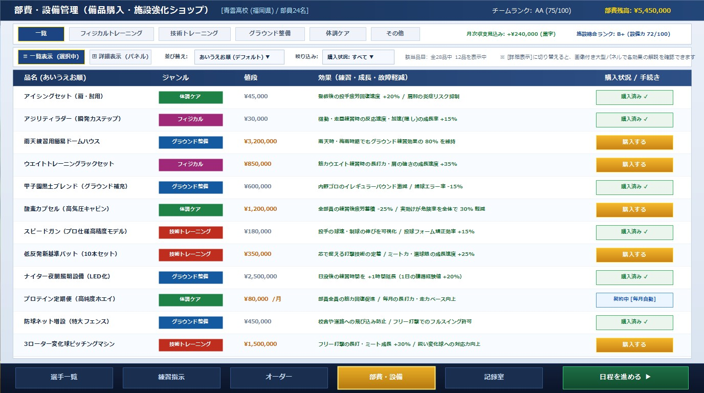

# 部費・設備管理画面 仕様書 (Budget & Facility Management Specification)

## 1. 概要とコンセプト
部費・設備管理画面は、プレイヤー（監督）が部活動予算（部費）を運用し、**練習器具の購入・強化、グラウンド環境のアップグレード、メディカルケア導入、および後援会・OB会からの支援金獲得**を行う画面である。

「たくさんの品物を手早く一覧比較してサクサク購入したい」ニーズと、「機材の写真や詳しい説明文・効果グラフをじっくり見たい」ニーズの双方に応えるため、**「長細い一覧表示（リスト形式）」と「大型パネルの詳細表示（カード形式）」の2大表示モード切り替え機能**を備える。

---

## 2. 画面レイアウト・デザインイメージ

### 2.1 【一覧表示モード】（デフォルト）
たくさんの品目（12〜15品以上）をスクロールを最小限に抑えて一度に一覧・比較・購入できる長細いテーブル形式。

### 2.2 【詳細表示モード】
各備品のイメージ写真、詳細な解説文、効果グラフ、現在レベルと上限レベルを大きなパネルで確認できる形式。

---

## 3. 主要機能と操作仕様

### 3.1 画面上部 6大カテゴリタブ
画面上部に以下の6つの分類タブを常設し、クリックで対象品目を即座に絞り込む。
1. **「一覧」**: 全カテゴリの品目をまとめて表示（デフォルト選択）。
2. **「フィジカルトレーニング」**: ウエイトラック、バーベル、アジリティラダー、メディシンボール等。
3. **「技術トレーニング」**: ピッチングマシン、低反発新基準バット、スピードガン、トスマシン等。
4. **「グラウンド整備」**: 甲子園黒土、雨天ドーム、夜間照明（ナイター）、防球ネット等。
5. **「体調ケア」**: アイシングセット、酸素カプセル、プロテイン定期便、マッサージガン等。
6. **「その他」**: 遠征用マイクロバス、作戦ボード、ビデオカメラ、部旗等。

---

### 3.2 コントロールバー（表示切替・ソート・フィルタ）
- **表示モード切替ボタン**:
  - `[≡ 一覧表示]`（長細いリスト表示・デフォルト）
  - `[⊞ 詳細表示]`（大きめパネル表示）
- **ソート機能**:
  - **デフォルト: 「あいうえお順（五十音順）」**
  - その他選択肢: 「値段が安い順」「値段が高い順」「ジャンル順」「購入状況順」
- **絞り込みフィルター**:
  - 「すべて」「未購入のみ」「購入済みのみ」
- **部費サマリー**:
  - 画面上部ヘッダーに現在の部費残高（例: `¥5,450,000`）を常時ゴールド表示。

---

### 3.3 一覧表示テーブルの列構成
1. **品名**: 備品・機材・契約名（あいうえお順で整列）。
2. **ジャンル**: カテゴリ別カラーバッジ（体調ケア:緑、フィジカル:紫、グラウンド:青、技術:赤）。
3. **値段**: 購入費用または月額費用（例: `¥45,000` 〜 `¥3,200,000`、月額は `¥80,000 /月`）。
4. **効果**: 練習効率向上、エラー軽減、疲労・故障抑制のパッシブ効果。
5. **購入状況 / アクションボタン**:
   - 未購入（所持金で買える）: ゴールドの `[購入する]` ボタン
   - 未購入（部費不足）: グレーアウト表示 `[部費不足]`
   - 購入済み: 緑枠の `[購入済み ✔]` バッジ
   - 月額サブスク: 青枠の `[契約中 [毎月自動]]` バッジ

---

### 3.4 収録アイテム一覧（五十音順・一部抜粋）
| 品名 | ジャンル | 値段 | 主な効果（全13パラメータ・疲労対応） | 状態 |
| :--- | :---: | :---: | :--- | :---: |
| **アイシングセット（肩・肘用）** | 体調ケア | ¥45,000 | 登板後の投手疲労回復速度 +20% / 肩肘の炎症抑制 | 購入済み |
| **アジリティラダー（瞬発力）** | フィジカル | ¥30,000 | 機動練習時の反応速度・加速(隠し)の成長 +15% | 購入済み |
| **雨天練習用簡易ドームハウス** | グラウンド整備 | ¥3,200,000 | 雨天時もグラウンド練習効果の 80% を維持 | 未購入 |
| **ウエイトトレーニングラックセット** | フィジカル | ¥850,000 | 筋力ウエイト練習時の長打力・肩の強さ成長 +35% | 未購入 |
| **甲子園黒土ブレンド（補充）** | グラウンド整備 | ¥600,000 | 内野ゴロエラー率 -15% / バウンド安定 | 購入済み |
| **酸素カプセル（高気圧キャビン）** | 体調ケア | ¥1,200,000 | 全員の疲労蓄積 -25% / 実効けが危険率 30% 軽減 | 未購入 |
| **スピードガン（高精度モデル）** | 技術トレーニング | ¥180,000 | 投手の最高球速・制球の伸びを可視化 / 矯正効率UP | 購入済み |
| **低反発新基準バット（10本）** | 技術トレーニング | ¥350,000 | 芯で捉える打撃技術 / ミート力・選球眼成長 +25% | 未購入 |
| **ナイター夜間照明設備** | グラウンド整備 | ¥2,500,000 | 放課後練習時間を +1h 延長（日々の獲得経験値+20%） | 購入済み |
| **プロテイン定期便（ホエイ）** | 体調ケア | ¥80,000/月 | 部員全員の筋力回復促進 / 毎月の長打・走力向上 | 契約中 |
| **防球ネット増設（特大フェンス）** | グラウンド整備 | ¥450,000 | 安全性確保 / フリー打撃でのフルスイング許可 | 購入済み |
| **3ローター変化球マシン** | 技術トレーニング | ¥1,500,000 | フリー打撃の長打・ミート成長 +30% / 変化球対応UP | 未購入 |
