# 高校野球シミュレーション5（KokoSim 5）基本設計書

**文書バージョン**: 2.0.0  
**最終更新日**: 2026年10月21日  
**ステータス**: 基本設計完了（サーバーレス・Firebase無料枠・B方式日程クォータ・チケット課金反映版）  

---

## 1. プロジェクト概要・基本コンセプト

### 1.1 プロジェクトの目的
本作「高校野球シミュレーション5（KokoSim 5）」は、プレイヤーが高校野球部の監督となり、チーム育成、練習機材の充実、オーダー編成、そして試合での采配を通じて甲子園優勝を目指す本格高校野球監督シミュレーションゲームである。

### 1.2 過去作（KokoSim 1〜4）からの継承と進化
過去シリーズ（1〜4）で培った以下の資産・クオリティを完全に維持・統合し、さらなる進化を遂げる。

1. **マネジメント基盤・能力体系の継承（KokoSim 実績ロジック）**:
   - 選手個々の詳細な能力値（長打力、ミート力、選球眼、走力、加速[隠し]、捕球力、度胸、肩の強さ、コントロール、投球フォーム、判断力、反応速度、変化球配列）
   - 多彩な特性・特殊能力（チャンス◎、アベレージヒッター、パワーヒッター、奪三振、フライボールバッター、キャッチャー◎、強肩 等）
   - 性格・調子（-5〜+5の11段階調子アイコン）・学年・背番号制、年間行事（入学式、合宿、卒業、定期大会）
2. **試合物理エンジンの統合・進化（KokoSim SM基盤）**:
   - 物理法則（重力・空気抵抗・スピン）に基づく投球・打球シミュレーション
   - 決定論的（Deterministic）なシミュレーションループによる完全な再現性
   - 9人守備AI（第一捕球者、カバーリング、バックアップ）および連鎖フォース走塁判定
3. **KokoSim 5 での新規・大幅強化ポイント**:
   - **完全サーバーレス＆クライアント高速実行（遅延ゼロ・永久0円インフラ）**
   - **全都道府県・全高校の完全網羅（約4,000校）**
   - **有名校のユニフォーム再現＆こだわりコスメティック解放**
   - **実寸比率のリアル球場シミュレーション**
   - **TV中継構図（投球画面）と迫力のクローズアップカメラ（打球画面）の完全連動**
   - **備品購入システムによる練習強化**
   - **記録室（都道府県予選・甲子園・通算成績）の大幅拡充**
   - **24時間で最大90日進められるソシャゲ型日程リチャージ ＆ チケット経済圏**

---

## 2. プレイヤー（監督）行動・育成システム設計

### 2.1 練習設定（メニュー別カンバンボード編成 ＆ 成長ロジック）
部全体の週間/月間練習方針を設定する（詳細はセクション5.1.3のカンバンボードUIと連動）。
- **メニュー別6大枠（誰がどこにいるかを一目で把握・ドラッグ＆ドロップ対応）**:
  - **打撃強化**: 長打力・ミート力・選球眼の向上（日々の疲労 +8%〜+10%）
  - **内野守備**: 捕球力・反応速度・判断力・コントロールの向上（疲労 +8%〜+10%）
  - **外野・機動**: 走力・加速・肩の強さ・打球判断の向上（疲労 +8%〜+10%）
  - **投手陣**: 肩の強さ・投球フォーム・コントロール・変化球キレの向上（疲労 +12%〜+15%）
  - **フィジカル・特守**: 度胸・基礎体力・筋力向上、特性開花（高負荷：疲労 +20%〜+25%）
  - **休養・ケア**: 疲労大幅回復（-35%〜-45%）・ケガ防止・調子上向き

#### 2.1.1 選手の「10大性格」システム
部員一人ひとりに個性（性格）が割り当てられ、練習効率やメンタルに明確な個性を与える。
- **努力家**（20%）: 全練習効率が常時 +15%。調子が崩れにくい。
- **熱血漢**（15%）: 「フィジカル・特守」成長率 +35%。疲労蓄積が +15% 増。
- **冷静・クール**（15%）: コントロール、選球眼、判断力成長率 +30%。エラー率激減。
- **職人気質**（12%）: 変化球キレ、捕球力、ミート力成長率 +35%。専門外練習は控えめ。
- **負けず嫌い**（10%）: 試合敗戦後やレギュラー剥奪時に翌月成長率 +40%。
- **ムードメーカー**（10%）: 好調時の成長率 +40%。ベンチにいるだけでチーム全体の士気・調子を底上げ。
- **キャプテン肌**（8%）: 同じ練習枠のチームメイト全員の成長率を +10% 底上げ。
- **マイペース**（5%）: 疲労蓄積が -25% 軽減。球場のプレッシャーを完全無視。
- **内気・シャイ**（4%）: 1年次は成長控えめだが、実戦出場で「度胸」上昇スピードが2倍の大器晩成。
- **天才肌**（1%）: 全パラメータの基礎成長率が常に +30% の稀代の逸材。

#### 2.1.2 選手の「5大成長タイプ」
- **超早熟**（5% / 1年成長率140% ➜ 3年60%）: 1年生から即戦力。
- **早熟**（15% / 1年120% ➜ 3年80%）: 下級生時からチームを牽引。
- **普通**（60% / 1年90% ➜ 2年100% ➜ 3年110%）: 標準的で着実な伸び。
- **晩成**（15% / 1年70% ➜ 3年140%）: 2年秋〜3年夏に急成長。
- **超晩成（覚醒）**（5% / 1年50% ➜ 3年180%）: 3年生で大化けするロマン枠。

#### 2.1.3 疲労ゲージ蓄積 ＆ ケガ（故障）発生ロジック
- **疲労度（0〜100%）とケガ発生率**:
  - `0%〜59%`（安全域・緑）: ケガ率 **0%**（完全安全）
  - `60%〜79%`（注意域・黄）: ケガ率 **1%**
  - `80%〜99%`（危険域・赤枠警告点滅）: ケガ率 **8%**（直ちに休養枠へ移すべき）
  - `100%`（限界突破・紫）: ケガ率 **25%**
- **ケガの期間（過度なストレス防止）**:
  - **軽傷**（70%）: 全治 **3日〜5日間**（打撲、突き指等）
  - **中等度**（28%）: 全治 **10日〜21日間（最長でも2〜3週間）**（肉離れ、捻挫等 / Safety Stop作動）
  - **重傷**（2%）: 全治 **1ヶ月〜2ヶ月間**（ごくごく稀な骨折等 / Safety Stop作動）
- **定期休養**: 毎週日曜日（週次自動休養）に全員の疲労が自動で **-20%** 回復。

#### 2.1.4 実戦での「度胸」上昇 ＆ 特殊能力開花
- **度胸（0〜100）**: 練習では上がりにくく、公式戦・練習試合のピンチや得点圏でのプレー（安打、無失点リリーフ）により大幅上昇。甲子園出場時は2倍の経験値を獲得。
- **特殊能力（特性）の開花**: 試合での劇的活躍（サヨナラ打、完封等）での自然覚醒、または年2回の夏冬合宿での「特訓スロット」による集中伝授。

※詳細な計算式や定数マトリクスは、[選手育成・能力成長＆疲労・ケガ計算システム詳細仕様書（training_and_growth_specification.md）](./training_and_growth_specification.md) を参照。

### 2.2 練習の個人割り振り（個別特化メニュー）
選手個別の課題に応じた個人指導・個別強化を行う。
- **野手の個別メニュー**:
  - ミート特化 / 長打特化 / 走力・加速特化 / 守備職人（捕球・反応速度向上） / 選球眼徹底
  - サブポジション習得（例: 外野手が二塁手の適性を獲得）
  - 打席左右の転向（スイッチヒッター練習、左打ち転向）
- **投手の個別メニュー**:
  - 球速向上（肩の強さ×フォーム改造） / コントロール徹底 / 度胸・スタミナ強化
  - 新変化球の習得（スライダー、カーブ、フォーク、チェンジアップ、シンカー、ツーシーム、カットボール等から選択）
  - 既存球種のキレ・落差の向上（各球種キレ 0〜100）
  - フォーム改造（オーバースロー、サイドスロー、アンダースロー）

### 2.3 備品の購入（練習の強化・部費マネジメント）
学校の評判や大会成績、後援会からの寄付によって得られる「部費（資金）」を活用し、練習効率や選手ケアを高める備品を購入・設備投資する。

| カテゴリ | 備品・設備名 | コスト | 効果 |
| :--- | :--- | :--- | :--- |
| **打撃器具** | ピッチングマシン（直球用/変化球用） | 15万円〜50万円 | 打撃練習のミート力・選球眼上昇率アップ |
| | ティースタンド＆サンドバッグ | 5万円 | 長打力練習効率アップ |
| **投球・守備器具** | スピードガン＆投球解析カメラ | 30万円 | 投手の投球フォーム・コントロール・変化球キレ上昇率アップ |
| | ノックマシン・リバウンドネット | 20万円 | 内野・外野の捕球力・反応速度練習効率アップ |
| **トレーニング** | ウエイト器具セット（バーベル/ダンベル） | 25万円 | 長打力・肩の強さ・筋力上昇率アップ |
| | アジリティラダー＆ミニハードル | 8万円 | 走力・加速・守備反応速度上昇率アップ |
| **コンディショニング** | アイシングセット・酸素カプセル | 10万円〜80万円 | 練習後の疲労蓄積軽減、怪我発生率低下 |
| | プロテイン・栄養サプリメント | 月額3万円 | 毎ターンの能力微増、成長限界引き上げ |
| **グラウンド整備** | 黒土追加・水はけ改善整備 | 50万円〜200万円 | グラウンドレベル上昇、全練習効率が永続アップ |

### 2.4 日程進行 ＆ 年間カレンダーシステム

本作の日程進行は、**「サクサク進む快適性」**と**「大事な試合・イベントを見逃さない確実性」**を両立した進行エンジンを採用。

#### 2.4.1 日程進行の3大アクションボタン ＆ 自動停止（Safety Stop）
メイン画面右下に、状況に応じて使い分けられる3つの進行ボタンを配置。
- **`[ ▶ 1日進める ]`**: 1日だけ進行（日々の調子推移や細かい練習配分を確認したい時）。
- **`[ ⏩ 1週間進める ]`**: 7日間一括進行（通常練習期間をサクサク進めたい時）。
- **`[ ⏭️ 1か月進める ]`**: 30日間高速進行（冬季オフシーズン等のスキップ用）。

**【自動停止（Safety Stop）の5大トリガー】**:
複数日（1週間/1か月）の一括進行中であっても、以下の事象が発生した瞬間に**ループを即座に中断して安全停止**します。
1. **公式戦当日**: 地方予選（春・夏・秋）、甲子園（春・夏）、明治神宮大会の試合前日および当日。
2. **予定された練習試合当日**: 週末に組まれている練習試合の当日朝。
3. **重要学校行事・学園イベント**: 入学式（新入部員入部）、体育祭、テスト週間開始、ドラフト会議、合宿開始、卒業式、抽選会など。
4. **無料進行クォータ枯渇**: 自然回復枠（残日数）が `0` に達した瞬間（チケット使用/購入モーダルを表示）。
5. **部員の重大アクシデント**: 練習中に主力選手が「全治2週間以上のケガ」を負った場合。

#### 2.4.2 年間365日固定スケジュール（学校行事 ＆ 公式大会）
高校生のリアルな学園生活（定期試験、体育祭、合宿、卒業式）と野球部の主要大会を網羅。
- **4月**: 4/8 入学式・新入部員入部（スカウト新入生合流、10名入部） / 4月中旬 春季地区予選開幕
- **5月**: 5月上旬 **春季都道府県大会**（夏のシード権争奪） / 5月中旬 1学期 中間テスト / 5月下旬 春季地区大会
- **6月**: 6月中旬 沖縄県 夏季選手権大会（全国最速開幕） / 6月下旬 地方大会組み合わせ抽選会 / 6月末 1学期 期末テスト（赤点注意）
- **7月**: ⚾ **夏の全国高校野球 地方選手権大会**（負けたら終わりの完全サバイバルトーナメント）
- **8月**: 🏟️ **夏の甲子園大会（全国高等学校野球選手権）** / 8月下旬 3年生引退・新チーム自動始動（キャプテン・主将の指名なし） / 8月末 夏季強化合宿（5日間：練習効率2倍）
- **9月**: 🍁 **秋季都道府県大会** 開幕（センバツへの一次関門、地区予選・敗者復活戦）
- **10月**: 10月上旬 🏃 **体育祭**（部活対抗リレー、部員の絆・士気向上） / 10月中旬 2学期 中間テスト / 10月下旬 ⚾ **秋季地区大会**（センバツ切符争奪） / 10月下旬 プロ野球ドラフト会議
- **11月**: 11月中旬 ⛩️ **明治神宮野球大会**（10地区王者激突、優勝地区にセンバツ「神宮大会枠 +1」付与） / 11月下旬 練習試合解禁期間
- **12月**: 12月上旬 2学期 期末テスト / 12月下旬 対外試合禁止期間（アウトオブシーズン） / 12月末 冬季強化合宿（基礎体力・度胸底上げ）
- **1月**: 1月中旬 オフシーズン室内練習・基礎トレーニング / 1月下旬 センバツ選考委員会（春の甲子園出場32校発表）
- **2月**: 2月中旬 学年末テスト / 2月下旬 センバツ組み合わせ抽選会
- **3月**: 3/1 卒業式（3年生旅立ち、OB進路報告・記念品差し入れ） / 3/8 対外練習試合解禁 / 3月下旬 🌸 **春の選抜甲子園大会（センバツ）**

#### 2.4.3 練習試合マッチングシステム（手動申込み ＋ 「名声度」自動オファー）
- **手動申込み**: カレンダーの空き週末を選び、近隣校へ部費（遠征費1万〜5万円）を消費して申し込む。
- **名声度連動オファー**: 各学校が持つ `reputation`（名声度 0〜100、Rank E〜S）に応じて、週末に他校から「ぜひ胸を貸してほしい」と打診が届く。
  - **強豪校（Rank S/A）**: 毎週のようにオファーが殺到。相手校が来校するため**「遠征費0円（部費消費なし）」**で効率的に実戦経験を積める。
  - **弱小校（Rank D/E）**: オファーがほぼ届かないため、自ら部費を支払って近隣校に頭を下げに行く必要がある。

#### 2.4.4 47都道府県の公式大会方式（春季・夏季・秋季の完全網羅）
全国47都道府県（49代表ブロック）の地域特性を反映した大会構造をシミュレート。
- **春季大会**: 地区予選を経て県大会へ進む県（神奈川、愛知、兵庫、福岡等）と、最初から全県一斉トーナメントの県（栃木、群馬、大阪、滋賀、高知等）。
- **夏季予選**: 全県一斉オープントーナメント（シード制導入）。沖縄県は全国最速の6月中旬開幕。北海道は北・南、東京は東・西の各2枠。
- **秋季予選**: 新チーム発足後のセンバツ一次関門。参加校の多い県（神奈川、千葉、静岡、兵庫、福岡等）では**「地区予選 ＋ 敗者復活戦」**を導入し、東京・大阪では**「ブロック一発勝負」**、参加校20〜40校程度の県（鳥取、佐賀、福井等）では**「地区予選なし全県一斉トーナメント」**を採用。上位2〜3校が10地区の秋季地区大会へ進出し、地区王者10校が11月の「明治神宮野球大会」で日本一を争う。

#### 2.4.5 年間365日 ランダムイベント完全体系（全120選）
高校生のリアルな日常、部活動、学業、地域交流、OBとの絆、そして四季の移ろいを情感豊かに描く全120種類のランダムイベントを搭載。
- **10大カテゴリ**:
  1. 春の日常・新入部員・新学期（桜の下の自己紹介、初めてのシートノック等 / 15選）
  2. 春季大会・練習試合・遠征（強豪からの対戦オファー、遠征バスのカラオケ等 / 10選）
  3. 夏の選手権直前・壮行・マネージャー（背番号授与式、手作りお守り、千羽鶴等 / 15選）
  4. 真夏の決戦・甲子園・猛暑（熱中症対策、甲子園練習15分間、浜風攻略等 / 12選）
  5. 夏合宿・地獄の特訓（避暑地合宿、砂浜ダッシュ、打ち上げBBQ等 / 10選）
  6. 新チーム結成・秋季大会・世代交代（新チーム始動ミーティング、敗者復活戦粘り、体育祭等 / 13選）
  7. プロ野球ドラフト・進路確定（ドラフト上位指名、社会人内定、硬式球寄贈等 / 8選）
  8. 冬期トレーニング・基礎錬成（タイヤ引き100本、木づち転圧、どんぶり飯3杯等 / 15選）
  9. 学業・テスト・学校生活・文武両道（定期テスト勉強会、赤点補習、美化表彰等 / 10選）
  10. 地域・ファン・OB差し入れ・ハプニング（マイクロバス寄贈、名物おじいちゃん等 / 12選）
※120イベントすべての説明・効果・発生確率・発生条件を網羅した一覧表は、[年間365日 ランダムイベント完全仕様書（random_events_specification.md）](./random_events_specification.md) を参照。

※47都道府県ごとの詳細な大会方式対比表、10地区枠内訳、および進行エンジンのTypeScript定義は、[年間カレンダー＆日程進行システム詳細仕様書（calendar_and_progression_specification.md）](./calendar_and_progression_specification.md) を参照。

### 2.5 試合中の監督作戦指示（采配システム）
プレイヤーは監督として、1球ごとの緊迫した局面において、ベンチから具体的・実戦的な作戦サインを指示する。
平時は **1.5x / 2.0x スピード**でサクサク進行し、ピンチ・チャンスや投手のスタミナ限界等の重要局面では **Auto-Pause（自動一時停止）** が作動して監督の采配を促す。精神論的な「打たせて取れ」「三振狙い」「おまかせ」を完全排除し、高校野球の現場に即した戦術コマンド体系を採用。

#### 攻撃側の作戦指示（打席中・走塁）:
- **打撃アプローチ**:
  - `[ ⚡ 積極打法 ]`: 初球・早いカウントから甘い球を狙い打つ（初球スイング率UP、甘い球の長打率UP）
  - `[ ➡️ 逆方向意識 ]`: 引っ張らず右打者は右、左打者は左へ流し打つ進塁打指示（外角球コンタクトUP）
  - `[ ⬇️ 低め見逃せ ]`: ワンバウンド変化球や低めボール球を徹底的に見極める（低めスイング率激減・四球獲得率UP）
  - `[ ⬆️ 高め見逃せ ]`: 釣り球となる高めボール球ストレートを見極める（フライアウト抑制）
  - `[ 💥 強振 ]`: 長打・本塁打を狙う強打スイング（打球初速UP、空振り三振率・ポップフライ率微増）
  - `[ 🎯 ミート重視 ]`: 確実に出塁・単打を狙うコンパクトな打撃（コンタクト率+30%・三振激減）
  - `[ ✋ 待球（待て） ]`: バットを振らず相手投手の制球難・球数消費・四球を狙う（スイング率0%）
- **小技・機動・奇襲**:
  - `[ ⚾ 送りバント ]`: 走者を確実に次塁へ進める犠打（成功率85〜95%）
  - `[ 🏃 セーフティバント ]`: 俊足打者が内野の意表を突いて出塁を狙う奇襲
  - `[ 🔥 ヒット＆ラン ]`: 投球と同時に走者がスタートし、打者がゴロを転がして一・三塁を作る（併殺完全防止）
  - `[ 🚨 スクイズ ]`: 三塁走者が投球と同時に本塁突入し、バントで1点を確実にもぎ取る
  - `[ ⚡ 盗塁 ]`: 走者単独または重盗で次塁を狙う
- **選手交代**:
  - `[ 👥 選手交代 ]`: 代打・代走専用モーダル（生還率プレビュー・次イニング守備予約連動）を展開

#### 守備側の作戦指示（投球・守備陣連動）:
- **戦術・配球警戒**:
  - `[ 🚨 ランナー警戒 ]`: クイックモーション徹底＆ストレート系配球増で盗塁・エンドランを封じる（盗塁阻止率+35%）
  - `[ ✋ 申告敬遠 ]`: 強打者との勝負を避け、投球数ゼロで打者を一塁へ歩かせる
  - `[ 📣 伝令を送る ]`: ベンチから伝令を走らせ内野手全員がマウンド集結。投手のスタミナ小回復（+10%）＆動揺解除（公式戦3回まで）
- **守備シフト切替**:
  - `[ 🛡️ 守備シフト切替 ]`: 局面に応じて4大陣形（①定位置 / ②前進守備 / ③併殺シフト / ④外野長打警戒）を即時切替
- **選手交代**:
  - `[ ⚾ 投手交代 ]`: 救援投手を投入する専用モーダル（現投手vs交代候補の2者直接比較）を展開
  - `[ 🛡️ 守備変更 ]`: 終盤の守備固め、ポジションスワップを実行

※作戦コマンドの詳細な効果ロジック・パラメータ補正およびAuto-Pauseの仕様は、[3D試合・リアルタイム作戦采配仕様書（match_system_specification.md）](./match_system_specification.md) およびセクション5.2.2を参照。

---

## 3. 全都道府県・全国実在校マスタ ＆ 大会・世代交代設計

### 3.1 全国の実在校網羅設計（実名完全収録 ＆ 2大参加モード）
本作の最大の売りである「圧倒的なリアル」を追求し、全国約4,000校の高校名を**実名完全収録**します。

- **網羅対象**: 47都道府県（49代表ブロック：北海道は北・南、東京は東・西）。
- **プレイヤーの高校参加モード**:
  1. **実在校を選択して就任**: 大阪桐蔭、横浜、仙台育英などの名門校、あるいは地元の公立校を選択して監督に就任。
  2. **新規作成校で参入**: オリジナルの高校名（例: 「青雲高校」）やユニフォームを作成し、任意の都道府県の予選に参入。
- **部員構成の全国統一規格**:
  - 全国の高校で**「1学年10名・全部員30名固定（1年10名、2年10名、3年10名）」**を採用。幽霊部員を抱えず、全員に役割が行き届くスッキリとしたチームマネジメントを実現。

#### 3.1.1 選手姓名辞書 ＆ 8,400億通り超モジュラーフェイス生成エンジン
毎年全国で40,000人（10年で40万人）の新入部員が誕生する本作において、**同姓同名や同じ顔の重複を完全排除**する生成エンジンを搭載。
- **都道府県特有名字辞書**: 全国共通名字（約1,000種）に加え、福岡（古賀、黒木、白水）、沖縄（比嘉、金城、大城）、岩手（工藤、佐々木）など地域特有名字テーブルを70%の比重で抽出し、地元の臨場感を再現。自校30名内の同姓同名は完全排除。
- **約8,428億通り（842,764,124,160通り）のアバターパーツ構成**: 輪郭12種 × 肌8段階 × 髪型32種 × 髪色6色 × 眉18種 × 目28種 × 瞳色6色 × 鼻14種 × 口18種 × 特徴12種 × 体格5段階 ＋ パラメトリック連続値微調整（$\pm 5\%$）により、実質無限のバリエーションを保証。
- **64bit Seedによる軽量化**: 画像データを持たず、選手1人あたり8バイトの `faceSeed` から決定論的にSVG/Canvas描画するためメモリ消費ゼロ。
※詳細仕様は [選手キャラクター＆ユニフォームデザイン仕様書（player_character_design.md）](./player_character_design.md) を参照。

### 3.2 基準戦力値（BaseRating） ＆ 戦力安定度（Stability）による新入生生成
全国4,000校の戦力やスカウティングを画一的な乱数で処理せず、各学校の過去実績と特性を忠実に再現します。

- **基準戦力値（BaseRating: 0〜100）**: 過去の甲子園出場実績・県大会戦績をもとに各学校の初期戦力を設定。
- **戦力安定度（Stability: 0〜100）**:
  - **名門校（Stability 90〜95）**: 盤石なスカウト網により、毎年ブレずにハイレベルな中学生が入部。
  - **中堅・公立校（Stability 50〜65）**: 年度によって「当たり年（黄金世代）」や「谷間の世代」が自然に発生。
- **プレイヤー校の「スカウトマン雇用」システム**:
  - 部費を支払って外部のプロスカウトマン（地域ベテラン、全国敏腕、元プロ等）と年間契約を結び、有望な中学球児を意図的にスカウト可能。

#### 3.2.1 「10年に1人の怪物（全国40万人の中から1人＝40万分の1）」システム
全国4,000校 × 10名 ＝ 毎年40,000人。10年間で全国に入部する高校球児40万人の中で、たった1人しか存在しない正真正銘の超弩級ルーキー。
- **全国年間発生率**: 毎年10%（10年に1度、全国のどこかに1人だけ誕生）。投手（50%）または打者（50%）。
- **他校ライバルとしての登場（大半のケース）**: 地方公立校や名門校に突如現れ、全国ニュース速報で報道。甲子園や県予選で立ちはだかる最強の壁となる。
- **自校への奇跡の入部（4万分の1 / 0.0025%）**: 万が一自校に現れた際は専用の黄金プレートとスカウト驚愕演出が発生。
- **能力スペック**:
  - **怪物投手**: 1年春時点で球速 150〜155km/h、制球 75〜82(B/A)、スタミナ 82〜88(A)、金特『怪童』『ドクターK』『マウンドの威圧感』所持。3年時にはMAX 160〜165km/h到達可能。
  - **怪物打者**: 1年春時点で長打力 88〜95(S)、ミート 76〜84(A)、走力 75〜82(A)、選球眼 85〜92(A/S)、金特『怪力アーチスト』『威圧感』『勝負師』所持。通算60〜100本塁打を量産。
※詳細仕様は [全国実在校マスタ＆トーナメント詳細仕様書（school_master_and_tournament_specification.md）](./school_master_and_tournament_specification.md) を参照。

### 3.3 甲子園常連校の実在ユニフォーム再現
名門・伝統校の個性あふれるユニフォームスタイルを徹底再現（自校のエディット作成も可能）。

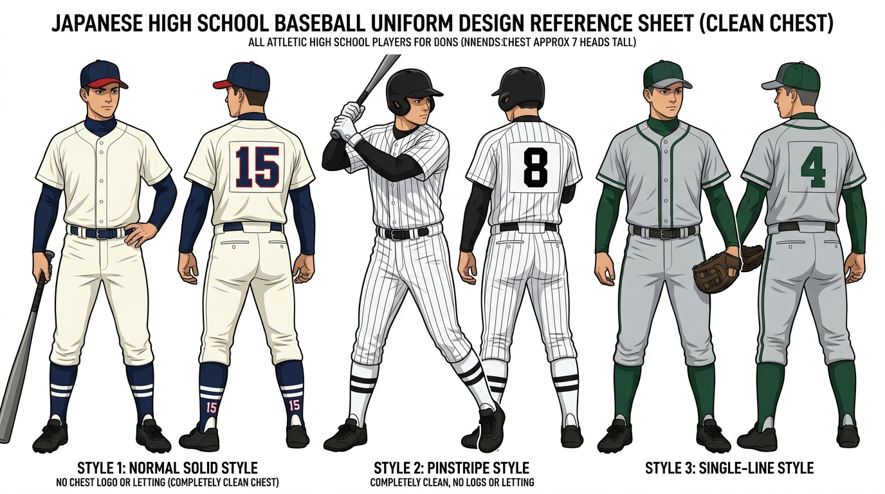

- **実在校の再現例**:
  - **大阪桐蔭**: オフホワイト（白）× 濃紺アンダーシャツ、濃紺単色キャップ
  - **横浜**: アイボリー × 濃紺、胸元・袖・パンツに紺のサイドライン
  - **星稜**: 伝統のイエローゴールド（山吹色）シャツ × 濃紺
  - **智弁和歌山 / 智弁学園**: 純白シャツ × 深紅（クリムゾンレッド）アンダー、白×赤キャップ
  - **早稲田実業**: アイボリー × 早稲田エンジ
  - **慶応**: 伝統のグレー（灰色）ユニフォーム × 濃紺ライン
  - **仙台育英**: 爽やかなスカイブルー（サックス）シャツ × 濃紺

### 3.4 トーナメント編成 ＆ 他校試合の自然なジャイアントキリング
- **シード校の均等配置**: 春季大会実績に基づき、第1〜第4シードをトーナメント山の四隅・各ブロックに公平配置。
- **他校試合のInning-by-Inningシミュレーション**:
  - 作為的な「○%で番狂わせを起こす」乱数フラグを完全排除。
  - 1イニングごとの打撃・投球・守備・エラーの簡易シミュレーションをミリ秒で実行。
  - 「無名公立のエースが強豪打線を散発に抑える」「タイムリーエラーから先制され焦って併殺打を連発する」といった**野球の試合展開の積み重ねの結果として自然にジャイアントキリングが発生**する本格設計。

### 3.5 世代交代・ドラフト会議 ＆ 卒業式・OB差し入れ
- **3年生引退（8月下旬）**: 夏の大会敗退翌日に引退（※効果が曖昧なキャプテン指名は排除し、新チームが自動始動）。
- **プロ野球ドラフト会議（10月下旬）**: 志望届を出した有力選手が上位・育成枠で指名される演出イベント。
- **卒業式 ＆ OB差し入れギミック（3月1日）**: 卒業生が進路（プロ、社会人、大学、スポーツショップ店員等）に進み、定期的にグラウンドを訪問して機材や部費、割引クーポンなどを差し入れしてくれる。

※詳細仕様は [全国実在校マスタ＆トーナメント・他校試合シミュレーション詳細仕様書（school_master_and_tournament_specification.md）](./school_master_and_tournament_specification.md) を参照。

## 4. 試合エンジン・物理演算・リアル球場設計

### 4.1 リアル球場寸法 ＆ 大会別球場選定仕様（実寸スケール再現）
球場はデフォルメせず、現実のメートル単位（m）で正確にモデリング。

#### 4.1.1 大会別 開催球場決定ルール（公式戦 ＆ 練習試合）
本作における全試合は、以下の高校野球公式ルールに基づき実在・架空球場が自動割り当てられます。

| 大会・試合区分 | 開催球場・選定ルール | 準決勝・決勝 | 1回戦〜準々決勝 | 特徴・仕様ポイント |
| :--- | :--- | :--- | :--- | :--- |
| **春・夏・秋の県大会** | **各都道府県の球場** | **メイン球場** | **サブ球場** | 全47都道府県のメイン球場（北九州市民、横浜、舞洲等）およびサブ球場（春日公園、保土ケ谷等）を完全収録。 |
| **夏・春の全国大会** | **阪神甲子園球場** | **阪神甲子園球場** | **阪神甲子園球場** | 両翼95m・中堅118m・フェンス3.2m。浜風（右翼→左翼）と名物黒土。 |
| **秋季地区大会（10地区）** | **地区内各県の持ち回り** | **当番県のメイン球場** | **当番県のサブ球場** | 地区内都道府県で毎年ローテーション（例: 九州地区は福岡→佐賀→長崎…）。開催県のメイン球場でセンバツ切符を争奪。 |
| **明治神宮野球大会** | **明治神宮野球場** | **明治神宮野球場** | **明治神宮野球場** | 両翼91.9m・中堅120m・フェンス3.3m。全面人工芝。学生野球の聖地。 |
| **練習試合（対外試合）** | **通常3種＋レア4種** | — | — | 下記の抽選確率テーブルに基づきランダム決定。 |

#### 4.1.2 練習試合用球場 ＆ レア球場仕様（全7種）
練習試合では、以下の通常3球場（各32%）と、低確率（各1%）で出現する特殊レア球場4種の計7球場から自動抽選されます。

| 区分 | 球場名 | 出現率 | 両翼 / 中堅 / フェンス高 | 特徴・3Dギミック |
| :--- | :--- | :---: | :--- | :--- |
| **通常** | **練習試合用球場A** | **32%** | **両翼 90m / センター 120m / フェンス 2m** | 標準的な地方市民球場規格。外野フェンス2mで本塁打が出やすい。 |
| **通常** | **練習試合用球場B** | **32%** | **両翼 85m / センター 118m / フェンス 3m** | 狭小球場。両翼85mと浅いがフェンス3m。直撃二塁打が出やすい。 |
| **通常** | **学校の球場** | **32%** | **両翼 88m / センター 116m / フェンス 2.2m** | **【3D演出】バックスクリーン後方に3階建て校舎（教室窓）と防球ネットが見える**自校・相手校グラウンド。 |
| **レア** | **牢獄球場** | **1%** | **両翼 70m / センター 100m / フェンス 20m** | **20mの巨大鉄壁・コンクリート高壁要塞**！越えるのは至難、壁直撃跳ね返りによる長打戦。 |
| **レア** | **縦長球場** | **1%** | **両翼 120m / センター 126m / フェンス 1.5m** | **両翼120mの超巨大フィールド**。ポール際本塁打はほぼ不可能、俊足外野手が有利。 |
| **レア** | **ヘンテコ球場** | **1%** | **左翼 100m / センター 115m / 右翼 70m / フェンス 3m** | **極端な左右非対称グラウンド**。ライト70mの激浅で左のプルヒッター天国。 |
| **レア** | **長細球場** | **1%** | **両翼 80m / センター 150m / フェンス 2m** | **両翼80m×センター150mの極端な縦長長方形**。中堅手の広大な守備範囲が試される。 |

※全国47都道府県のメイン球場・サブ球場一覧および詳細諸元は、[全国47都道府県球場マスタ仕様書（stadium_master_specification.md）](./stadium_master_specification.md) を参照。

### 4.2 投球・変化球物理モデル（ハイブリッド・パラメトリック軌道計算）
- **3D座標系**:
  - 原点 $(0, 0, 0)$: ホームベース後端
  - $X$軸: 一塁側（正）、三塁側（負）
  - $Y$軸: マウンド・センター方向（正）
  - $Z$軸: 上方向（正）
  - 投手リリースポイント: $Y \approx 16.5\text{m} \sim 17.5\text{m}$, $Z \approx 1.8\text{m} \sim 2.1\text{m}$
- **「物理演算（マグヌス効果）＋ 3次ベジェ曲線」ハイブリッド計算モデル**:
  - 狙ったコース（$P_3$）への確実な制御と、打者の手元での鋭いキレ（空気抵抗・マグヌス力）を両立。
  - 球速 $V$ から到達時間 $T$（150km/hで約0.42秒、130km/hで約0.48秒）を算出し、時間進捗 $u = t/T$ に対して **$u^3$（3次加速）** で変化変位量を重畳。
- **球種別の変化特性**:
  - **ストレート**: バックスピン揚力により重力落下を相殺。球威が高いほどホップして見える。
  - **スライダー**: $u > 0.6$（ベース手前5m）から外角斜め下へ鋭くスライド。
  - **カーブ**: 序盤に山なりに一度浮き上がり、そこから大きな弧を描いて急降下（緩急差）。
  - **フォーク / SFF**: $u > 0.7$（ベース手前3m）から下方向加速度が急増し、打者の手元でストンと消える。
  - **チェンジアップ**: 直球と同じ腕の振りから抜ける遅球・ブレーキ沈降軌道。
  - **シンカー / スクリュー**: 利き腕方向へ沈みながら鋭く食い込む。

### 4.3 打撃・接触判定・打球物理
- **接触品質（Contact Quality）**:
  - スイング軌道と投球通過点の一致度（芯からの距離 $\Delta r$）：打者の**ミート力 (0〜100)** および **選球眼 (0〜100)** に応じて変動。
  - タイミング誤差（$\Delta t$：早いと引っ張り、遅いと流し打ち）。
  - 上下のズレ：特性（例: `フライボールバッター` はボール下側を捉えるバックスピン軌道補正がかかりやすい）。
- **打球初速・発射角・打球方向**:
  - スイング速度：打者の**長打力 (0〜100)** × 接触品質 ＋ 投球の反発力。
  - リアルな空気抵抗（揚力係数、抗力係数）による放物線・バウンド計算。
  - **度胸 (0〜100)** による得点圏・プレッシャー場面でのスイング品質補正（度胸が高いほど平常心を維持）。

### 4.4 守備・送球・走塁AI
- **守備陣の連動（9人同時評価）**:
  - `DefensiveCoordinator` が打球の落下地点・バウンド予測から各野手の役割を即時算出。
  - **反応速度 (0〜100)**: 打球に対する一歩目の初動タイムラグを決定。
  - **走力 (0〜100)**: 最高巡航速度。
  - **加速 (0〜100・隠し値)**: トップスピードに達するまでの加速度。
  - **捕球力 (0〜100)**: バウンド打球の処理安定度、ファンブル・後逸エラー率。
- **送球判断・リスク計算**:
  - **判断力 (0〜100)**: 最も失点期待値を下げる進塁阻止塁への送球判断、カットマン（中継）選択。
  - **肩の強さ (0〜100)**: 送球初速（レーザービーム特性で減速抑制）。
  - **コントロール (0〜100)**: 送球ターゲットへの精度。悪送球・ワンバウンド送球の発生率。
- **投手球速・制球**:
  - 投手の最高球速: **肩の強さ (0〜100)** × **投球フォーム (0〜100)** の係数演算により最終決定（例: 肩94×フォーム60 → 146km/h）。
  - コマンド力: **コントロール (0〜100)** により狙った捕手構え位置への到達ブレ幅を決定。
  - 変化球のキレ: **変化球配列 (各球種 0〜100)** に応じて変化量・曲がり始めの遅さを決定。

---

## 5. 画面構成・UI/UX設計

### 5.1 通常画面（マネジメント画面群）

#### 1. メイン画面（ホームダッシュボード）
- **ビジュアルコンセプト**:
  - 学校グラウンド（練習場）を舞台とし、奥に校舎が見えるアングル。
  - 選手たちは監督が指示した練習メニュー（フリー打撃、シートノック、ランニング等）をリアルタイムに実行するアニメーションを描画。
  - **校舎の垂れ幕ギミック**: 地方大会決勝進出や甲子園出場・全国制覇などの戦績に応じて、奥の校舎壁面に掲示される巨大な垂れ幕（「目指せ甲子園！」「祝 甲子園出場！」等）が動的に変化。
- **UIレイアウト構成**:
  - **画面上部（ヘッダー）**: 学校名・都道府県名（例: `[青雲高校 (福岡県)]`）、チーム名声ランク（Rank A）、部費（所持金）。
  - **画面右上（カレンダーウィジェット）**: デフォルト時は画面を遮らない**半分のコンパクトサイズ**（日付＋予選カウントダウン）。マウスホバー（タッチ時はタップ）で**月間カレンダーグリッド（マス目・試合アイコン⚾表示）へ滑らかに拡大展開**。
  - **画面中央（メインビジュアル）**: グラウンド練習風景（バッティングケージ、内野ノック、外野走塁）＋奥の校舎（垂れ幕）。
  - **画面下部（固定フッターバー）**: 主要画面への固定遷移ボタン（`[選手一覧]` `[練習指示]` `[オーダー]` `[部費・設備]` `[記録室]` `[日程を進める ▶]`）。
- **イメージ画像**:
  - 平常時（デフォルト：半分のコンパクト表示）：
    
  - ホバー時（月間カレンダーグリッド展開）：
    
  ※詳細仕様は [通常画面仕様書：メイン画面（main_screen_specification.md）](./main_screen_specification.md) を参照。

#### 2. 選手一覧画面（ロスター管理）＆ 詳細ポップアップ
- **コンセプト**:
  - 部員全員（1〜3年生、約18〜30名）の能力、適性、調子、特性能力（特殊能力）を俯瞰してチーム編成や育成方針を決める管理画面。
  - テーブル形式の一覧性を備え、**任意の選手行をクリックすると詳細ポップアップモーダルが展開**。
- **一覧テーブル列定義**:
  - `[顔/背番号]` `[氏名]` `[学年 (1〜3年)]` `[メイン]` `[サブ (適性○△)]` `[打撃 (長打・ミート)]` `[守備 (走・肩・捕球・反応)]` `[投手 (肩・フォーム・制球)]` `[特性]` `[調子 (-5〜+5)]`
- **フィルタ・ソート**: ポジション別（投・捕・内・外）、学年別（3年・2年・1年）、能力順ソート
- **選手詳細ポップアップモーダル（行クリック時）**:
  - **選手能力体系（全項目 MAX 100）**:
    - 長打力（スイング速・打球初速）、ミート力（コンタクト）、選球眼（見極め）、走力（トップスピード）
    - 加速（トップ到達速度：内部隠しパラメータ）
    - 捕球力（守備・エラー率）、度胸（プレッシャー耐性・実戦で上昇）、肩の強さ（送球速・基礎球速）、コントロール（送球正確性・投手制球）、投球フォーム（肩×フォームで最終球速決定）、判断力（状況判断）、反応速度（打球初動）
    - 変化球（各球種のキレ値の配列データ）
    - その他：投打（利き腕）、特性（フライボールバッター、キャッチャー◎、強肩等）、調子（-5〜+5の11段階）
  - **打撃成績（3大区分の常時集計・対比表示）**:
    - ①通算成績（練習＋公式＋全国の合算） / ②公式戦成績（地区・県予選） / ③全国大会成績（甲子園限定）
    - 表示指標：打率、試合、打数、安打、本塁打、打点、三振、四球、盗塁、出塁率、OPS
- **イメージ画像・モックアップ**:
  - 選手一覧テーブル画面：
    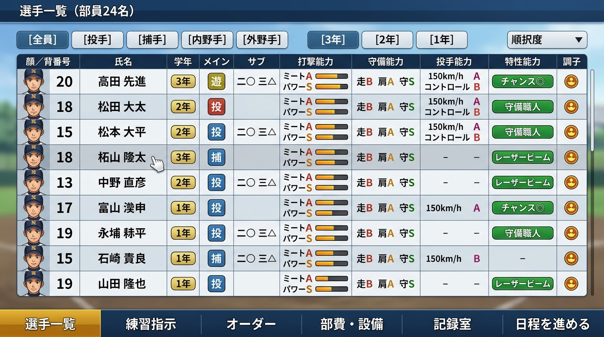
  - 選手詳細ポップアップモーダル：
    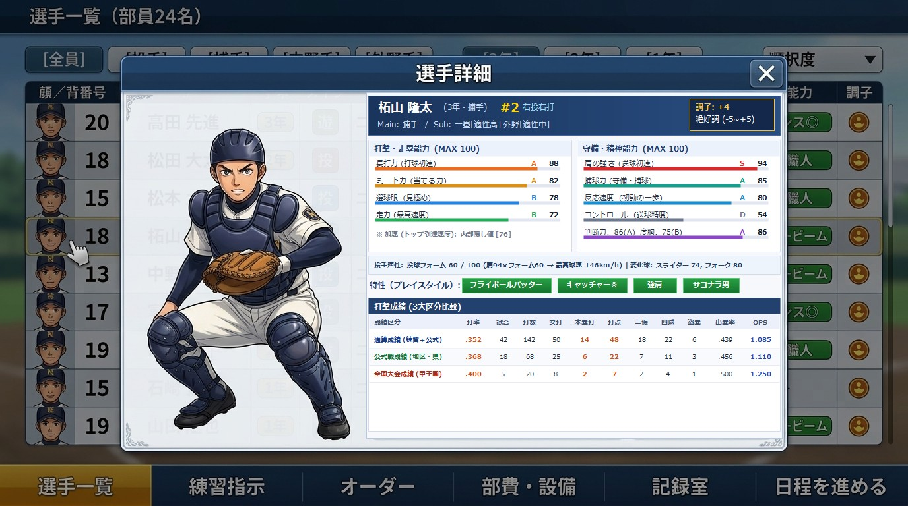
  - インタラクティブUIモックアップ：[player_detail_mockup.html](./player_detail_mockup.html)
  ※詳細仕様は [通常画面仕様書：選手一覧画面（player_list_specification.md）](./player_list_specification.md) を参照。

#### 3. 練習指示画面（メニュー別ボード ＆ ドラッグ編成 ＆ 全員に設定）
- **コンセプト**:
  - 一人ひとりプルダウンを設定する煩雑さを排除し、**「練習メニューごとに誰がいるか」が一目で把握できるカンバンボード形式**を採用。
  - 直感的な**選手チップのドラッグ＆ドロップによる練習変更**と、ワンタップで全部員を一括適用できる**「全員に設定」機能**を提供。
- **画面構成と操作体系**:
  - **メニュー別大型カード（6枠グリッド）**: 打撃強化、内野守備、外野・機動、投手陣、フィジカル・特守、休養・ケア。各枠に負荷、けが率、成長パラメータ、参加人数、参加部員のチップ（背番号・氏名・位置・疲労度ゲージ）を一覧表示。
  - **ドラッグ＆ドロップ編成**: 選手チップを掴んで目的の練習枠へ落とすだけで瞬時に練習変更。疲労80%以上の選手（例: #6 佐藤駿 88%）は赤枠で強調され、「休養・ケア」枠へ簡単にエスコート可能。
  - **「全員に設定」ボタン**: 各カード右上のボタンを押すと、部員全員（24名）がその練習へ一斉適用される。
  - **上部バーのクイック機能**: `[全員を全体休養に]`、`[ポジションおまかせ ▼]`、表示モード切替（`[メニュー別ボード]` ⇄ `[部員一覧リスト表示]`）。
- **イメージ画像**:
  
  ※詳細仕様は [通常画面仕様書：練習指示画面（training_screen_specification.md）](./training_screen_specification.md) および [選手育成・能力成長＆疲労・ケガ計算システム詳細仕様書（training_and_growth_specification.md）](./training_and_growth_specification.md) を参照。

#### 4. オーダー設定画面（スタメン・打順・守備配置・2選手比較入れ替え）
- **コンセプト**:
  - 1番〜9番の打順、守備配置、投手起用ローテーション、および勝負どころを握るベンチ作戦要員を決定・管理する。
  - 「左リストでシンプルに選び、右カードで2選手の能力を直接対比し、ボタンまたはミニ球場D&Dで直感的に変更する」という、プレイヤーの思考と試行錯誤を強力に支えるUI/UXを実現。
- **画面構成**:
  - **上部バー**: サブタブ（`スタメン・打順編成` `投手陣・継投設定` `ベンチ作戦要員` `ベンチ入り登録`）、`[おまかせ自動編成 ▼]`（調子・打力・守備・学年優先）、`[ 💾 オーダー保存 ]`。
  - **左ペイン（スタメン打順一覧 ＆ 入れ替え操作パネル）**:
    - 名前のみのすっきりした1〜9番リスト（打順・守備・背番号・氏名・学年/投打・調子アイコン）。
    - 2選手をクリックして選択可能（選択A:青枠、選択B:橙枠）。
    - 下部に直感入れ替えボタン群（`[ ⇅ 打順を入れ替える ]` `[ 🛡️ 守備位置を入れ替える ]` `[ 🔄 完全スワップ ]` `[ ✕ 選択解除 ]`）を常時配置。
  - **右ペイン上段（守備配置ミニ球場 ＆ D&Dエリア）**:
    - 外野芝・黒土ダイヤモンドの美しいミニ球場に9ポジションの選手ピン（守備位置・氏名・適性◎◯⚠️）を視覚配置。
    - **グラウンド上で選手ピン同士を直接ドラッグ＆ドロップ（D&D）して守備位置を瞬時にスワップ可能**。
    - チーム守備レーティング（内野守備S、外野守備A、捕手肩力S、二遊間連係S、左右打席比）をリアルタイム算出。
  - **右ペイン下段（選択選手 2者直接比較カード）**:
    - 選択した2選手（例: 3番・三塁 鈴木 vs 5番・遊撃 佐藤）の詳細ステータス、調子アイコン、特性バッジ、守備適性、大会成績を左右に並べて直接対比。
    - 采配サマリー比較（打撃・調子は鈴木優勢、遊撃守備適性は佐藤優勢など）を提示し、打順昇格や守備維持の判断を支援。
- **イメージ画像**:
  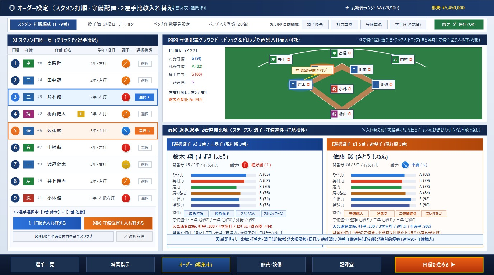
  ※詳細仕様は [通常画面仕様書：オーダー設定画面（order_screen_specification.md）](./order_screen_specification.md) を参照。

#### 5. 部費・設備管理画面（備品購入・施設強化・ショップ）
- **コンセプト**:
  - 部活動予算（部費）を運用し、練習器具の購入・強化、グラウンド環境のアップグレード、メディカルケア導入、後援会・OB会からの支援金獲得を行う。
  - 「たくさんの品物を一度に素早く一覧・購入したい」要望と「画像付きパネルで詳細を見たい」要望を両立する**「一覧表示」と「詳細表示」の切り替えUI**を導入。
- **画面構成**:
  - **上部6大カテゴリタブ**: `[一覧]`（デフォルト） `[フィジカルトレーニング]` `[技術トレーニング]` `[グラウンド整備]` `[体調ケア]` `[その他]`。
  - **コントロールバー**: 表示切替（`[≡ 一覧表示]` ⇄ `[⊞ 詳細表示]`）、ソート（**デフォルト: あいうえお順** / 価格順 / ジャンル順）、絞り込み（未購入のみ / すべて）。
  - **【一覧表示モード】（デフォルト）**: 長細いテーブル形式で12〜15品以上を一度に一覧表示。列定義：`品名 (あいうえお順)` `ジャンル` `値段` `効果（練習成長率UP、エラー軽減、疲労・怪我抑制）` `購入状況/ボタン（購入済み✔、購入する、契約中）`。
  - **【詳細表示モード】**: 大きめのカードパネル形式で写真・イラスト、詳細な機材解説文、効果グラフを表示。
- **イメージ画像**:
  
  ※詳細仕様は [通常画面仕様書：部費・設備管理画面（facility_screen_specification.md）](./facility_screen_specification.md) を参照。

#### 6. 記録室画面（レコードルーム）
- **コンセプト**:
  - 自チームの過去すべての戦績・名勝負スコアボードを振り返り、個人・チームの大会記録、全国47都道府県の地方予選および甲子園のトーナメント表、歴代優勝校、全国戦力ランキングを網羅する総合アーカイブ。
- **画面構成**:
  - **画面上部6大タブ**:
    - `[戦績]`（デフォルト）：自チームの全対戦（練習試合含む）一覧。**最新の試合が一番上**。行クリックで右側にスコアボードが即座に表示される2ペインUI。列項目（No、大会名、スコア、日付）で各項目ソート可能。
    - `[個人記録]`：全公式大会（練習試合除く）の個人栄誉。「1試合記録」と「大会記録」を切り替え閲覧。
    - `[チーム記録]`：全公式大会（練習試合除く）のチーム記録。「1試合記録」と「大会記録」を切り替え閲覧。
    - `[過去大会戦績]`：過去の全公式大会の結果（トーナメント表）。**トーナメントの山（試合カード）をクリックすることで該当試合のスコアボード詳細がポップアップ表示**。
    - `[歴代優勝校]`：全国大会（センバツ・選手権）の歴代優勝校・準優勝校・決勝スコア一覧。
    - `[戦力ランキング]`：全国約4,000校の総合力（総合ランク、投手力、打撃力、守備力、機動力）による全国格付けランキング。
  - **メインコンテンツ（戦績タブ表示時）**:
    - **左ペイン（戦績一覧テーブル）**: `No ▲▼` `大会名 ▲▼` `対戦相手 / スコア ▲▼` `日付 ▲▼` のソート可能テーブル。フィルタ（すべて、公式戦、甲子園、練習試合）。
    - **右ペイン（行クリック連動スコアボード詳細）**: 9イニング本格スコアボード（R/H/E）、責任投手・バッテリー、本塁打、主要選手スタッツ、監督戦評・ハイライトテキスト、スコアブック展開ボタン。
- **イメージ画像（全6大タブ）**:
  - 【過去大会戦績タブ】昔ながらの日刊スポーツ風新聞トーナメント表（シード直通罫線・赤太線勝ち上がり・山クリック連動）：
    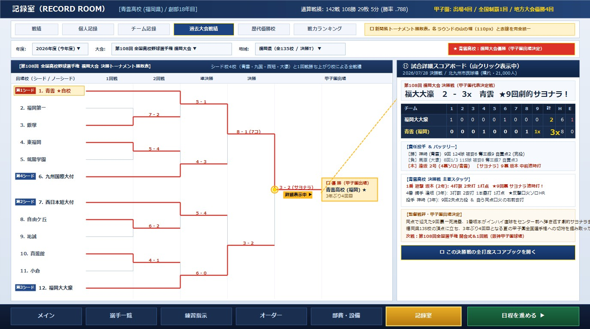
  - 【戦績タブ】自チーム全戦績一覧テーブル ＆ 行クリック連動スコアボード詳細：
    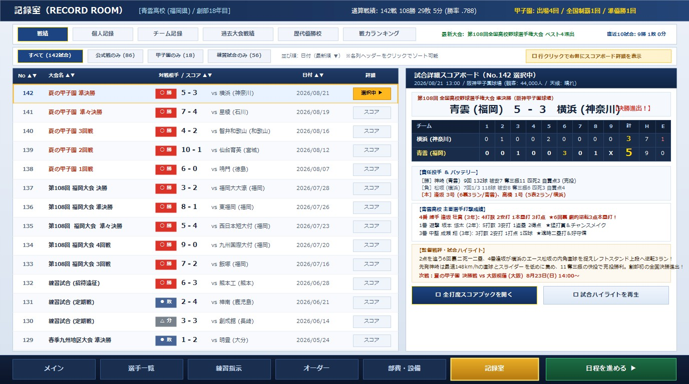
  - 【個人記録タブ】公式戦歴代 1試合記録 ＆ 大会・通算記録 殿堂カード：
    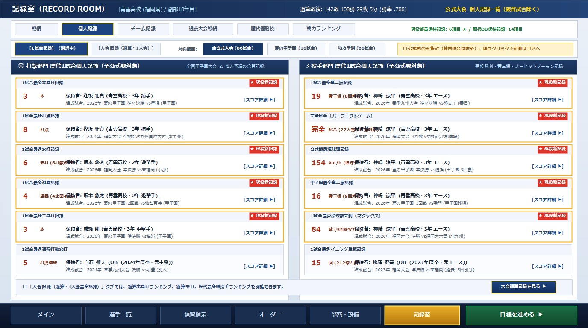
  - 【チーム記録タブ】公式戦歴代 打撃・守備 チーム最高記録：
    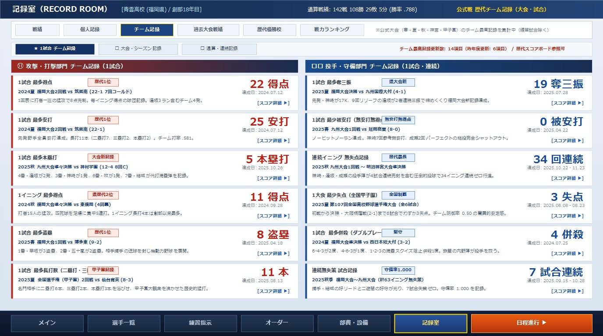
  - 【歴代優勝校タブ】甲子園全国大会アーカイブ ＆ 都道府県別優勝数ランキング：
    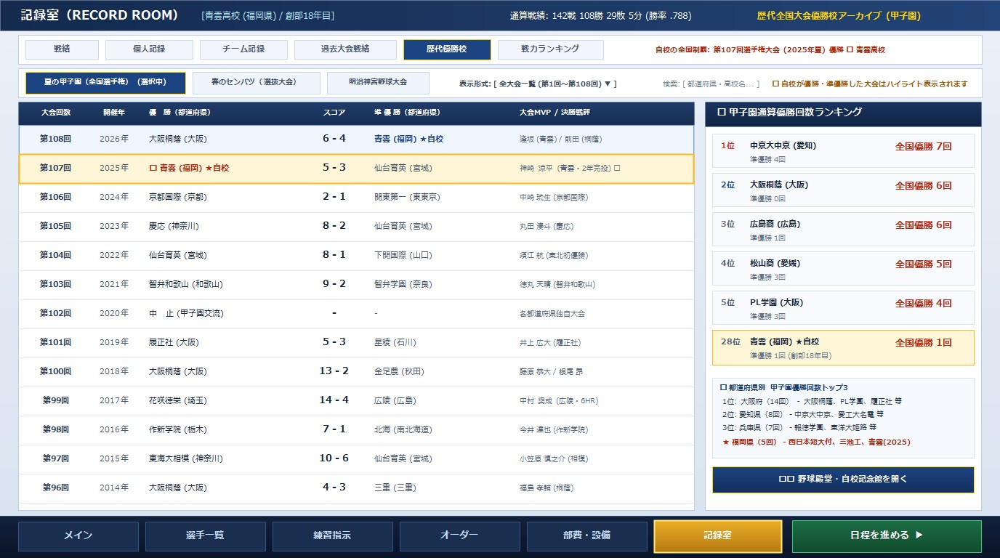
  - 【戦力ランキングタブ】全国4,000校AIスカウティング分析 ＆ ライバル校レーダー比較：
    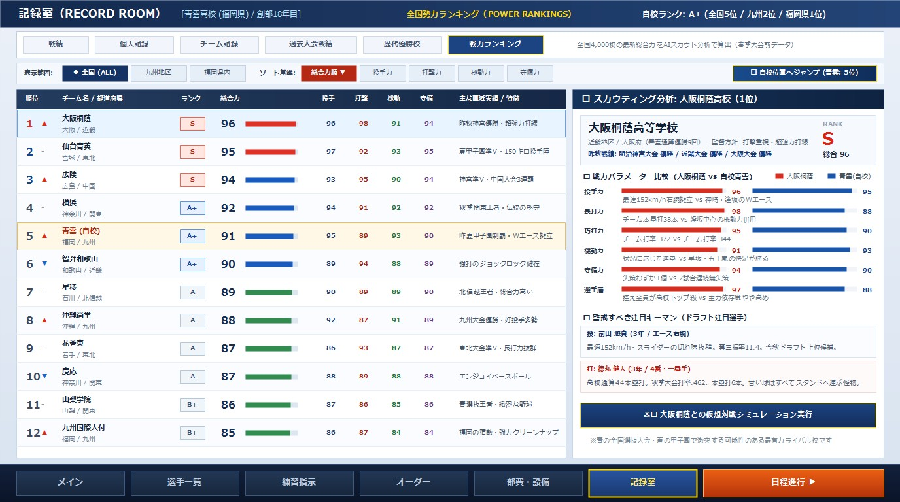
  ※詳細仕様は [通常画面仕様書：記録室画面（record_screen_specification.md）](./record_screen_specification.md) および統合HTMLビューワー [record_screen_viewer.html](./record_screen_viewer.html) を参照。

#### 7. 新入部員入部式 ＆ スカウト成果報告画面（4月8日イベント）
- **コンセプト**:
  - 4月8日の新入生入部発表。全国統一仕様の「1学年10名・全部員30名固定」に基づき、雇用したスカウトマンが発掘した10名のルーキーたちを白基調の美しいカードグリッドで一覧する春の重要イベント画面。
- **画面構成**:
  - **トップヘッダー**: 学校名・県名、`🌸 2026年度 新入部員入部式` バッジ、担当スカウト（全国敏腕スカウト坂本重雄等）の顔写真と総括戦力評価コメント。
  - **メインエリア（10名グリッド：5列×2行）**:
    - 各新入生の顔写真、背番号・氏名、ポジション・投打、出身チーム（シニア・ボーイズ）、10大性格バッジ（努力家、熱血漢、天才肌等）、成長タイプ、初期能力値（長打、ミート、走力、捕球、球速、変化球）、期待度星評価（★）。
  - **ボトムフッターバー**: `新入部員: 10名合流 (全部員数: 30名)`、`[ 📋 選手名鑑・ロスターへ登録する ▶ ]`、`[ ⚾ オーダー・練習編成へ進む ]`。
- **イメージ画像**:
  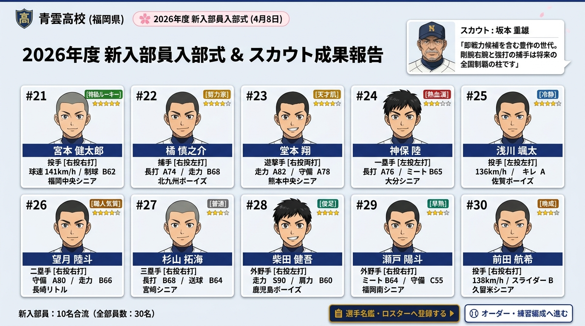
  ※詳細仕様は [全国実在校マスタ＆トーナメント・他校試合シミュレーション詳細仕様書（school_master_and_tournament_specification.md）](./school_master_and_tournament_specification.md) を参照。

#### 8. プロ野球ドラフト会議 運命の指名画面（10月下旬イベント）
- **コンセプト**:
  - 10月24日、プロ志望届を提出した3年生の運命のドラフト指名イベント画面。白基調の本格スポーツ経営UIに、アニメ調の感動的な記者会見・胴上げシーンと、テレビ中継風の電光掲示板（ドラフト1位・交渉権確定）を融合。
- **画面構成**:
  - **トップヘッダー**: 学校名・県名、`⚾ 2026年 プロ野球ドラフト会議` バッジ、指名速報テロップ。
  - **左ペイン（感動のドラマシーン）**: 本格スポーツアニメ調イラストによる記者会見・部室の歓喜シーン、テレビ中継ドラフト速報（`【第1巡目 選択希望選手】 福岡ソフトバンク：神崎 隼人`）、`[交渉権確定]` 赤短冊バッジ。
  - **右ペイン（指名選手ステータス ＆ 契約条件カード）**: 指名順位（ドラフト1位ゴールドバッジ）、指名球団、推定契約金（1億円/年俸1,600万円）、高校通算実績、プロスカウト評価コメント、自校名声度アップ（Rank Sへ昇格）および将来のOB最高峰差し入れ特典。
  - **ボトムフッターバー**: `本日の指名: 青雲高校より 1名指名`、`[ 📸 記者会見・セレモニーを終える ▶ ]`、`[ 📋 全国12球団 指名一覧を見る ]`。
- **イメージ画像**:
  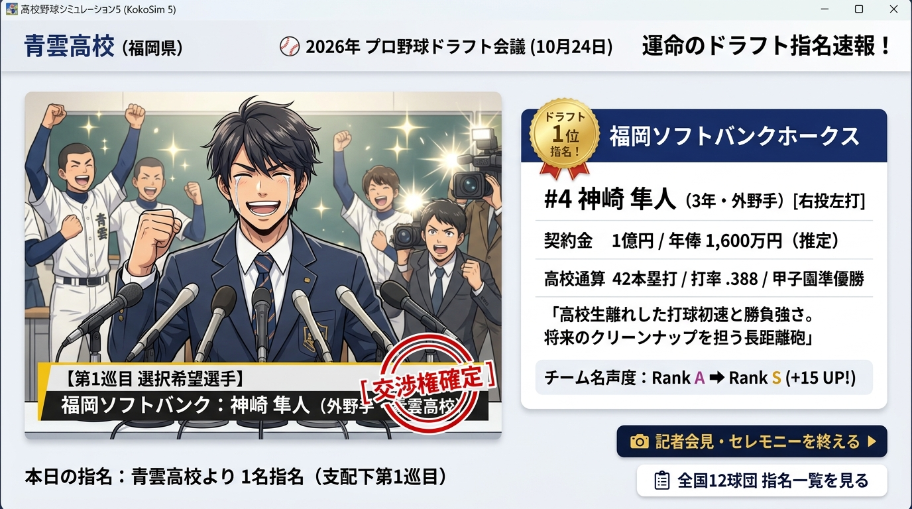
  ※詳細仕様は [全国実在校マスタ＆トーナメント・他校試合シミュレーション詳細仕様書（school_master_and_tournament_specification.md）](./school_master_and_tournament_specification.md) を参照。

#### 9. チームセットアップ画面（高校選択 ＆ 新規作成 2ステップ・ウィザード）
- **コンセプト**:
  - ニューゲーム開始時に表示される初期導入フロー。「実在校から選ぶ（全国約4,000校）」または「新規高校を作成する（オリジナル校名・ユニフォームデザイン）」を、無理のない2ステップのウィザード形式で決定する。

##### ①【ステップ1】都道府県 ＆ 高校選択画面（実在校データベース ＆ 新規作成切替）
- **画面構成**:
  - **左ペイン**: 地方ブロックタブ（九州・沖縄、近畿、関東等）、47都道府県リスト（例: 福岡県 135校加盟）、県別大会サマリー。
  - **中央ペイン**: その県の実在校一覧データベーステーブル（九州国際大付、福岡大大濠、東福岡、修猷館など）。検索窓、公立/私立フィルタ、甲子園実績、名声ランク。
  - **右ペイン**: 選択校のクイックプロファイルカード（戦力A84、特徴コメント、部員30名固定）。
  - **フッター**: `[ ✏️ 新規高校作成へ切替 ]`、`[ 次へ：ユニフォーム詳細設定へ進む ▶ ]`。
- **イメージ画像**:
  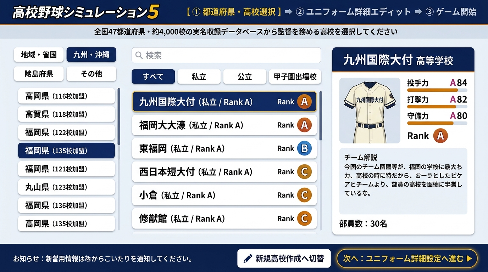

##### ②【ステップ2】ユニフォーム詳細エディット ＆ 就任決定画面（全身立ち姿プレビュー）
- **画面構成**:
  - **左ペイン**: 詳細ユニフォームカスタマイザー（①帽子の色、②ヘルメットの色、③3大デザイン[1:Normal / 2:縦じま / 3:中央ライン]、④上着の色、⑤アンダーシャツの色、⑥パンツの色、⑦ソックスの色・デザイン）。
  - **右ペイン**: 選択・作成したユニフォームを頭の帽子から足元のソックス・スパイクまで完璧に身にまとったスポーツアニメ調の選手「全身立ち姿」モデル、初期名声ランク（Rank D）、部員数30名規格、初期部費（¥1,500,000）、エントリー大会情報。
  - **ボトムフッターバー**: `[ ↺ リセット・最初から ]`、`[ ⚾ この高校・ユニフォームで監督就任する！ ▶ (Enter) ]`。
- **イメージ画像**:
  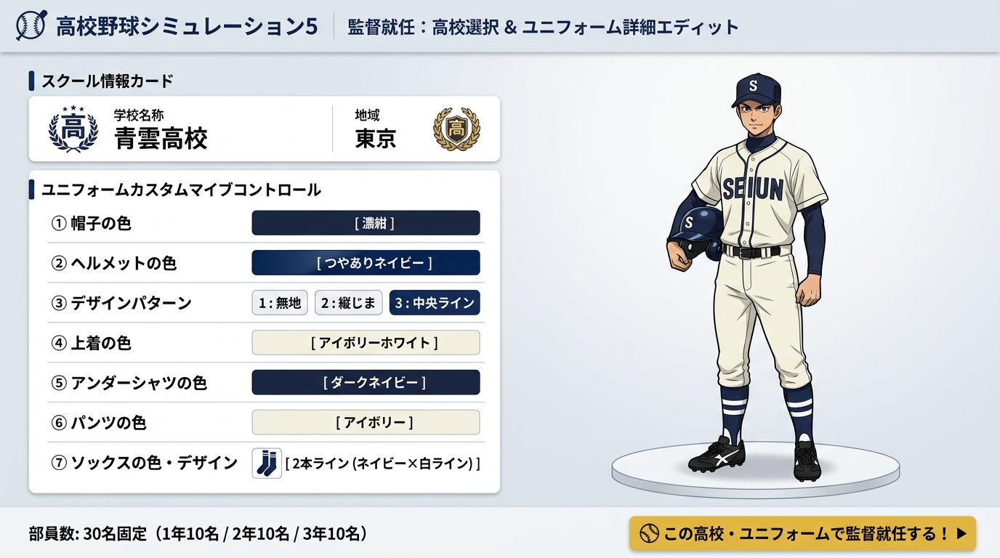

  ※詳細仕様は [全国実在校マスタ＆トーナメント・他校試合シミュレーション詳細仕様書（school_master_and_tournament_specification.md）](./school_master_and_tournament_specification.md) を参照。

#### 10. 卒業式 ＆ OB進路発表画面（3月1日イベント）
- **コンセプト**:
  - 3月1日、3年間共に戦った3年生10名の卒業式イベント画面。制服姿（赤いコサージュ）の卒業アルバム風カードで、高校通算実績、プロ・社会人・大学・スポーツショップなどの進路先、および将来のOB差し入れ効果（機材寄贈、臨時コーチ、部費寄付等）を発表・一覧する。
- **画面構成**:
  - **トップヘッダー**: 学校名・県名、`🌸 2027年3月1日 卒業証書授与式` バッジ、感謝メッセージ（`「監督、3年間熱いご指導を本当にありがとうございました！」`）。
  - **メインエリア（10名グリッド：5列×2行）**: 各卒業生の制服アニメポートレート、通算実績（42本塁打等）、決定した進路先バッジ（プロソフトバンク、トヨタ自動車、明治大学、ミズノ等）、将来のOB差し入れ特典。
  - **ボトムフッターバー**: `※卒業生は「名誉OB」として殿堂入りし、今後定期的にグラウンドを訪問します`、`[ 📸 卒業記念写真を記録室に保存する ]`、`[ 🌸 卒業生を見送り、春のセンバツへ進む ▶ (Enter) ]`。
- **イメージ画像**:
  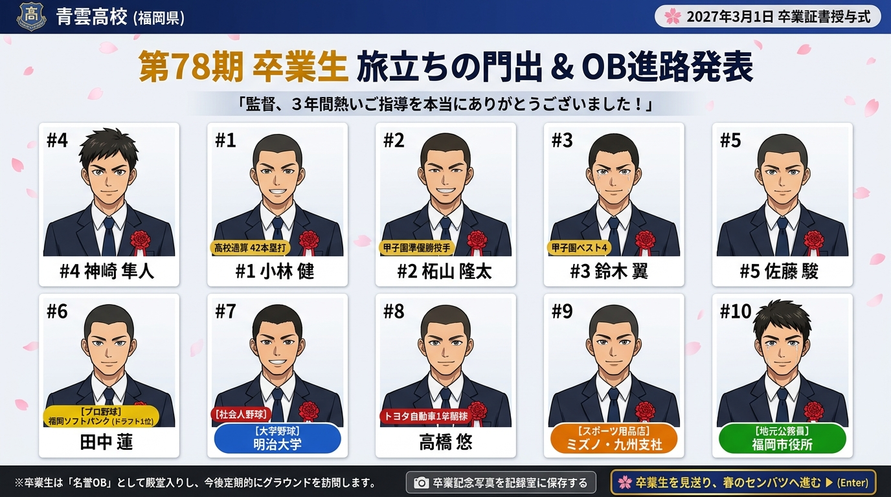
  ※詳細仕様は [全国実在校マスタ＆トーナメント・他校試合シミュレーション詳細仕様書（school_master_and_tournament_specification.md）](./school_master_and_tournament_specification.md) を参照。

---

### 5.2 大会・試合進行画面群

#### 5.2.1 実施中大会画面（アクティブ・トーナメント・ダッシュボード）
春・夏・秋の公式大会および甲子園大会の期間中、通常メイン画面から切り替わって表示される大会進行ベースキャンプ画面。


- **画面構成**:
  - **上部進捗バー**: 初戦から甲子園全国制覇までの勝ち上がりロードマップ。右端に「甲子園まであと2勝」のカウントダウン。
  - **左ペイン（ベスト4激突トーナメント表 ＆ 速報ニュース）**:
    - 現在勝ち残っている4強の山（自校の第1試合10:00激突、第2試合13:00予定）。
    - 他球場のLIVEニュース速報（満員御礼、他地区代表決定、スカウトの耳寄りメモ）。
  - **右ペイン（本日の決戦：次戦マッチアップ ＆ 徹底スカウティング分析）**:
    - 巨大対戦カード（青雲 A+/91 vs 九州国際大付 A+/89）。
    - 予想先発（最速154km/hエース神崎 vs 最速148km/h剛腕左腕小手川）。
    - **戦力レーダーチャート（5軸多角形グラフ）による両校直接比較 ＆ パラメーター優勢分析テーブル**（投手・打撃・機動・守備・選手層）。自校（青）と相手校（赤）の戦力バランスを一目で把握。
    - 要注意キーマン情報（通算39発の4番馬原、俊足巧打の1番白石）。
    - 監督ミーティング指示方針。
    - **決定アクションボタン**: `[ ⚔️ 試合前準備（スタメン・オーダー決定）へ進む ▶ ]`
    - **「大会ガイド」HTML出力機能**:
      - 画面右上および下部に `[ 📖 大会ガイド (HTML出力) ]` ボタンを配置。
      - 過去作で大好評だった**「参加校の戦力分析・登録選手名鑑・大会展望コラム」を美麗なHTML形式で出力・ブラウザで自動オープン**する機能。
      - 大会展望、勢力ピラミッド、ドラフト注目選手TOP4、全参加校の登録部員20名テーブルを完全収録。
      
      ※実際のブラウザ出力サンプル: [tournament_guide_sample.html](./tournament_guide_sample.html)
  ※詳細仕様は [画面仕様書：実施中大会画面（active_tournament_specification.md）](./active_tournament_specification.md) を参照。

#### 5.2.2 試合画面（3Dビュー＆カメラワーク確定仕様）

試合画面は、テレビ中継のリアルな臨場感と戦況把握を両立した**「投球画面」**と、プレーの現場を迫力満点に追従する**「打球画面」**の2大画面で構成されます。

#### 1. 投球画面（TV中継画角：Pitch Broadcast View）
甲子園の超巨大スタンドの熱気と、左右で美しく対比された情報HUDが特徴のメイン画面です。

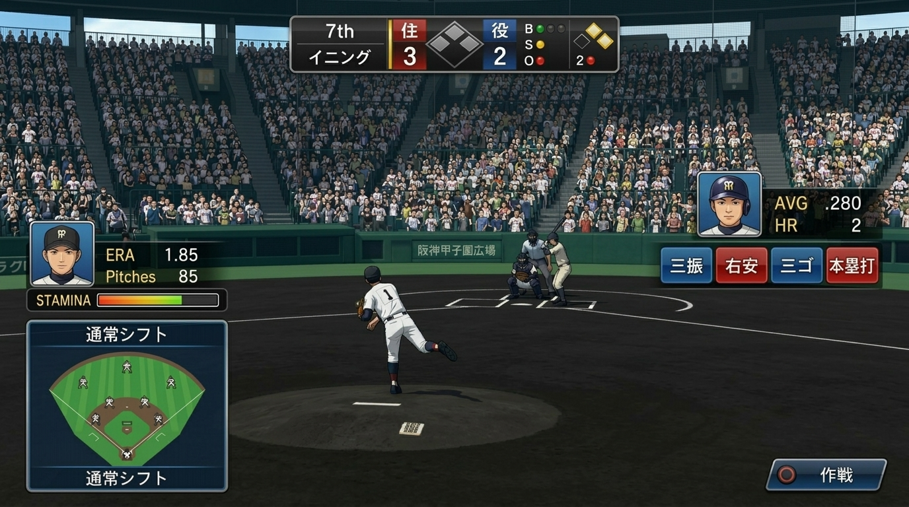

- **ビジュアル・演出の特徴**:
  - **甲子園のスケール感**: センター望遠カメラ（FOV ^\circ \sim 14^\circ$）特有のタイトな画角により、上空の銀傘は見切れ、画面上部いっぱいまでそびえ立つ何万人もの超巨大すり鉢状スタンド（満員の黄色メガホン応援）を描写。地方球場とは圧倒的に差別化。
  - **黒土と天然芝**: 甲子園独特の深い黒土マウンドと鮮やかな外野芝生のコントラスト。
- **画面HUDレイアウト**:
  - **投手パネル（画面左側）**: 帽子顔アイコン、ERA 1.85、85 Pitches、**横長スタミナゲージ（緑→黄→赤）**
  - **打者パネル（画面右側）**: ヘルメット顔アイコン、通算成績（AVG .280 / HR 2）、**直下に1打席ごとの結果カラータイル（凡退＝青、安打＝赤）**
  - **上部中央スコアボード**: 7th イニング、スコア（3 - 2）、BSOカウントランプ、1・2塁走者点灯
  - **左下ミニマップ**: **「通常シフト」**等の守備体系ラベル表示、9人の守備位置ドット表示
  - **右下「作戦」ボタン**: 画面を遮らないスマートな単一ボタン。クリックで作戦一覧ドロワー（ミート/強振、バント、盗塁、守備シフト、投手交代等）を展開

#### 2. 打球画面（動的クローズアップ＆カメラワーク遷移：Dynamic In-Play View）
打球発生時、プレーの臨場感と戦況把握を最大化するため、**2段階のカメラワーク遷移**を行います。

##### ① 打った直後：内野全景ハイアングル ＆ トラッキングHUD（全体把握：約0.3〜0.5秒）
バックネット裏スタンド上段からの見下ろし俯瞰画角で、内野ダイヤモンド全体と打球コースを一瞬で全体把握。
**画面左下には、投手の球速・球種、打者の打球速度（Exit Velocity）と打球角度（Launch Angle）をリアルタイム表示するトラッキングHUD（TRK-STATS）**を搭載。

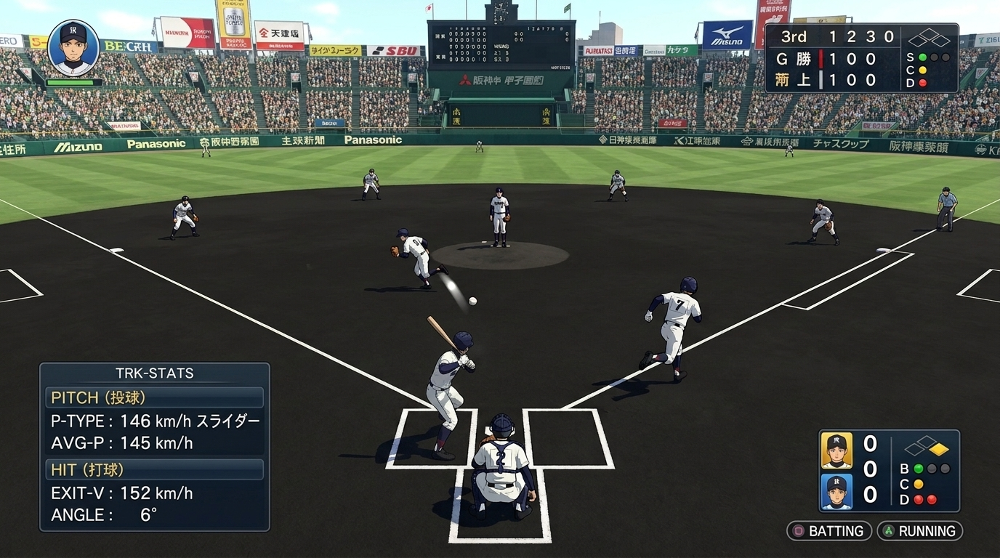
##### ② 捕球の瞬間：寄りの映像（現場クローズアップ：約0.5〜0.8秒）
カメラが遊撃手の足元へ急行。黒土を巻き上げて滑り込み、逆シングルで捕球するスーパープレーを至近距離でダイナミックに演出。

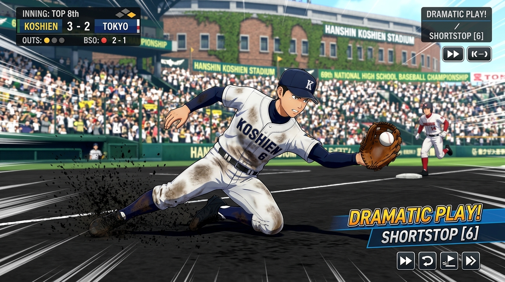

##### ③ 一塁到達クロスプレー＆判定
一塁ベース上へカメラがパンし、送球到達と走者の足の駆け抜けを至近距離で捉え、アウト/セーフの判定コール演出。

#### 3. カメラワーク設定機能（プレイヤー選択）
- **ダイナミック演出（推奨・デフォルト）**: 【内野ハイアングル俯瞰 → 野手寄りクローズアップ → 一塁クロスプレー】とカットがドラマチックに切り替わる迫力重視モード
- **中継固定（クラシック）**: ハイアングル俯瞰のままカメラがスムーズにパンし、全体を見渡し続ける戦況把握重視モード
- **シンプル / 高速スキップ**: 演出を最小限にしてサクサク進行する周回育成モード

#### 4. 1球采配・監督作戦コマンド ＆ Auto-Pause仕様
- **1球采配モード**: 全投球ごとに監督がサインを指示可能。平時は **1.5x / 2.0x スピード**でサクサク進行。
- **リアルな作戦コマンド**:
  - **攻撃時**: `[ ⚡ 積極打法 ]` `[ ➡️ 逆方向意識 ]` `[ ⬇️ 低め見逃せ ]` `[ ⬆️ 高め見逃せ ]` `[ 💥 強振 ]` `[ 🎯 ミート ]` `[ ✋ 待球 ]` `[ ⚾ バント ]` `[ 🔥 エンドラン ]` `[ 🚨 スクイズ ]` `[ ⚡ 盗塁 ]`
  - **守備時**: `[ 🚨 ランナー警戒 (クイック・直球増) ]` `[ 🛡️ 守備シフト (前進/併殺/外野深め) ]` `[ ✋ 申告敬遠 ]` `[ 📣 伝令 ]` `[ ⚾ 投手交代 ]`
- **Auto-Pause（自動一時停止）**: 得点圏チャンス、終盤ピンチ、投手スタミナ限界時に自動停止して采配を喚起。
※詳細仕様は [3D試合・リアルタイム作戦采配仕様書（match_system_specification.md）](./match_system_specification.md) を参照。

#### 5.2.3 試合前オーダー作成画面（本日のスタメン・対戦相手対策）
実施中大会画面から「試合前準備へ進む」を押下した際に遷移する、実戦突入直前の最終スタメン編成画面。

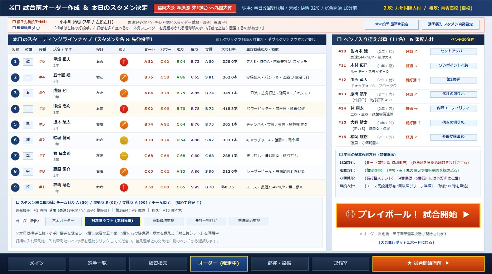

- **ビジュアル＆機能構成**:
  - **相手先発投手スカウト情報 ＆ 監督戦術メモ**: 相手エース（左腕・小手川 最速148km/h・スライダー武器）の特性を上部に常時掲示。
  - **本日の調子反映（調子アイコン）**: 選手ごとの当日のバイオリズム（絶好調↑〜絶不調↓）を文字ではなく直感的な調子アイコン（5段階サークルバッジ＋方向矢印）で視認可能。
  - **スマート自動編成ボタン**: `[ 🎯 対左投手 最適化 ]`、`[ ⚡ 調子優先 スタメン ]`、`[ ↺ 平常オーダー読込 ]` のワンクリックアシスト。
  - **スタメン9名テーブル ＆ ベンチ控え11名カード**: 左右ドラッグまたはクリックで直感的に入れ替え。守備適性の重複・不適をリアルタイム検知。
  - **守備ダイヤモンドグラフィック**: グラウンド上に9名の守備位置と守備適性（◎/○/△）を視覚的に配置。
  - **決定ボタン**: `[ ⚾ このオーダーで試合開始！ ▶ ]` で白熱の試合画面へ突入。
  ※詳細仕様は [試合前オーダー・選手交代仕様書（match_order_and_substitution_specification.md）](./match_order_and_substitution_specification.md) を参照。

#### 5.2.4 試合中選手交代画面（守備時／攻撃時 戦況連動 采配モーダル）
試合中の緊迫した局面（ピンチでの継投、得点圏での代打・代走、終盤の守備固め）において、通常オーダー画面で好評の「左リスト ＋ 右上ミニ球場（D&D操作対応） ＋ 右下2選手直接比較カード」のUI思想を全面的に踏襲した本格采配ダイアログです。

守備時（グラウンド守備9人、継投・守備シフト・伝令）と攻撃時（打席の打者、塁上の走者、代打・代走、次イニング守備予約）で状況・操作対象・UIが特化設計されています。

##### ①【守備時】選手交代画面（ピンチ・継投・守備固め・伝令）
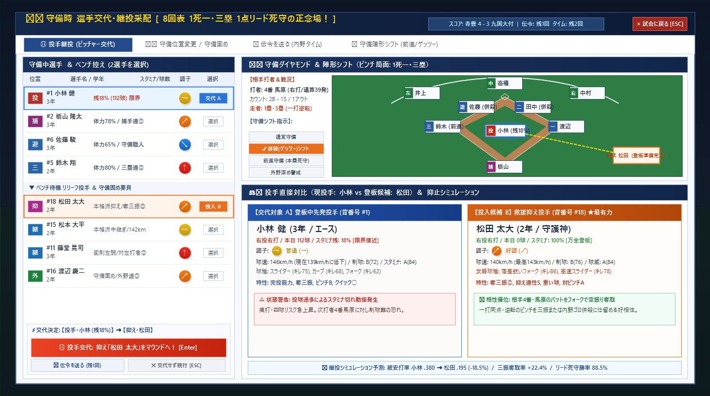

- **守備時のビジュアル＆機能構成**:
  - **局面**: 8回表 1死一・三塁 [4-3 1点リード死守] ピンチの場面。
  - **左ペイン（守備中9名 ＆ ベンチ控え）**: 出場中守備陣（先発・小林 残スタミナ18%危険バー・調子↘）とベンチリリーフ陣（抑え・松田）をリスト化。
  - **右上ミニ球場（走者状況・守備シフト・D&D操作）**: 一塁・三塁走者と守備陣9名を視覚化。ベンチ投手からマウンドへD&Dで瞬時継投、野手同士のD&Dで守備位置スワップ。
  - **右下2選手直接比較カード（守備・継投）**: 現投手（小林 健 / 142km/h / 被安打率.286）vs 交代候補（松田 秀一 / 148km/h / 守護神 / 被安打率.142）の詳細能力を直接比較し、中央の「⚾ 投手交代」ボタンでワンクリック交代。
  - **伝令機能**: `[ 📣 伝令を送る (残1) ]` でマウンド集結・スタミナ微回復・動揺解除。

##### ②【攻撃時】選手交代画面（チャンス・代打・代走・次守備予約）
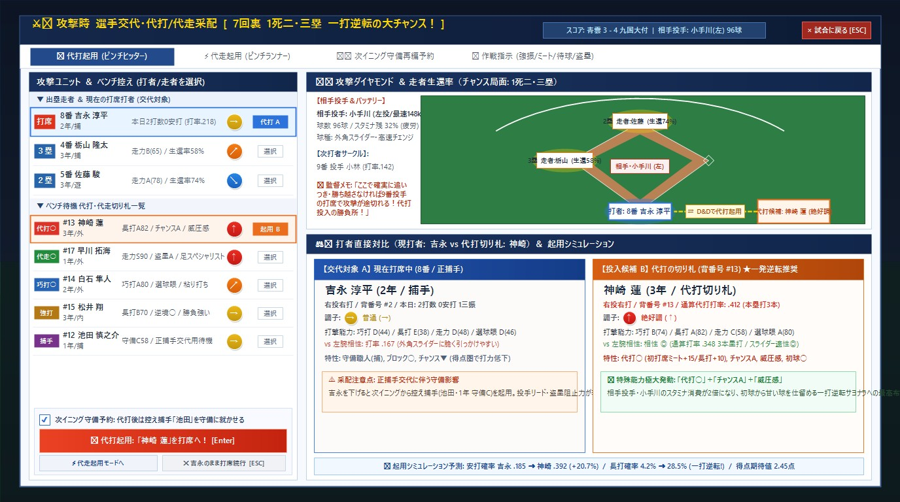

- **攻撃時のビジュアル＆機能構成**:
  - **局面**: 7回裏 1死二・三塁 [3-4 1点ビハインド] 一打逆転の大チャンス。
  - **左ペイン（攻撃中ユニット ＆ ベンチ代打代走）**: 打席の打者（8番捕手・吉永）、3塁走者（栃山）、2塁走者（佐藤）と、ベンチ代打（神崎：絶好調・長打A・代打○）、代走（早川：走力S90）を明示。
  - **右上ミニ球場（本塁・走者クローズアップ＆生還率プレビュー）**: 本塁打者と塁上走者にフォーカス。左ベンチから本塁へのD&Dで代打投入、各塁へのD&Dで代走投入。代走投入時の生還率急上昇（58% ➜ 92%）をリアルタイムプレビュー。
  - **右下2選手直接比較カード（打者・代打比較）**: 現打者（吉永 / 巧打D44 / 打率.185）vs 代打（神崎 / 巧打B74・長打A82 / 打率.392 / 長打率28.5%一発逆転予測）の直接比較。
  - **次イニング守備予約**: `☑ 代打後は控え捕手「池田」を守備に就かせる` の連動チェックにより、正捕手交代ジレンマを解消。

※詳細仕様は [試合前オーダー・選手交代仕様書（match_order_and_substitution_specification.md）](./match_order_and_substitution_specification.md) を参照。

#### 5.2.5 試合結果画面（白基調・公式スコアカード仕様）
他画面（通常オーダー、練習、大会、記録室等）とトーン＆マナーを統一した、**明るい白基調（ライトテーマ）**の試合終了公式スコアカード画面。MVPや戦評などのソシャゲ的なお飾りを完全に排除し、純粋な高校野球の公式記録（自校打撃成績、自校投手リレー、相手校投手成績、チームスタッツ対比）を大きな文字で美しく一覧できるストイックな情報設計を採用しています。

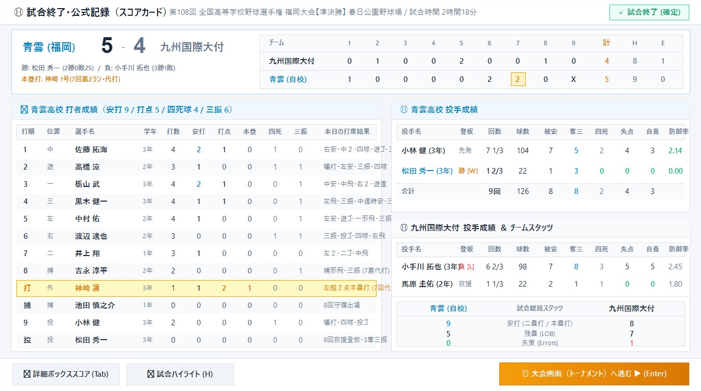

- **ビジュアル＆機能構成**:
  - **白基調クリーンデザイン**: 背景に淡いライトグレー（`#f4f6fa`）、カードに純白（`#ffffff`）とソフトなブルーの境界線を採用。
  - **最上部サマリー＆ラインスコア**:
    - 大文字スコア: `青雲 (福岡) 5 - 4 九州国際大付`（大きくシンプルに表示）
    - 責任投手・本塁打: `勝: 松田 / 負: 小手川 / 本塁打: 神崎 1号(7回裏2ラン・代打逆転)`
    - 1〜9回のフルイニングスコア（R / H / E）。7回裏の逆転2得点マスを淡いゴールドでハイライト。
  - **左ペイン（青雲高校 打撃成績テーブル）**:
    - 1〜9番＋代打・守備交代選手（全12名）の打撃成績（打順、位置、選手名、学年、打数、安打、打点、本塁打、本日の打席結果）。
    - 1行34pxのゆったりした行高と大きな文字フォントにより、モバイルでも快適に閲覧可能。
  - **右ペイン上部（青雲高校 投手リレー成績テーブル）**:
    - 先発・小林（7回1/3 104球 3自責点）から救援・松田（1回2/3 22球 3奪三振無失点 [W]）への継投成績およびチーム合計。
  - **右ペイン下部（九州国際大付 投手成績 ＆ チーム総括スタッツ）**:
    - 相手エース・小手川（6回2/3 98球 8奪三振 5失点 [L]）および救援・馬原の投球スタッツ。
    - 最下段に安打数（9 vs 8）、残塁数（5 vs 7）、失策数（0 vs 1）のチーム比較をシンプルに表示。
  - **最下部アクションバー**:
    - `[ 📊 詳細ボックススコア (Tab) ]` `[ 🎬 試合ハイライト (H) ]`
    - `[ ⚾ 大会画面（トーナメント）へ進む ▶ (Enter) ]`: 押しやすい大きなアクションボタン。

#### 5.2.6 詳細ボックススコア画面（公式完全記録・Play-by-Play）
リザルト画面から `[ 📊 詳細ボックススコア ]` を押下した際に展開する、公式記録員目線の完全データ画面。

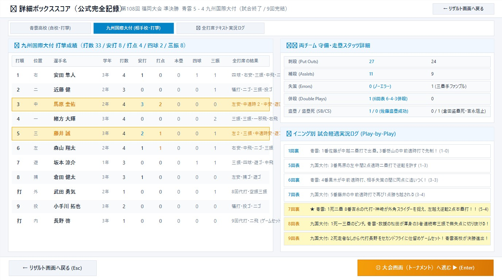

- **ビジュアル＆機能構成**:
  - **3大タブ切替**: `[ 青雲高校 (自校) ]` / `[ 九州国際大付 (相手校) ]` / `[ 📋 全打席テキスト実況ログ ]`
  - **相手校の完全打撃成績**: 相手1〜9番打者の全成績（馬原の3安打猛打賞、緒方の2三振無安打など）を一覧し、勝因・敗因を深掘り分析。
  - **守備・走塁スタッツ詳細**: 刺殺（PO）、補殺（A）、失策（E）、併殺（DP）、盗塁/盗塁死（SB/CS）の完全照合。
  - **イニング別実況テキストログ (Play-by-Play)**: 「7回裏 代打神崎の逆転2ラン本塁打」「8回表 松田の3者連続奪三振」など、全打席の経過をタイムライン形式で再現。

#### 5.2.7 試合3Dハイライト再生画面（名場面リプレイシアター）
リザルト画面から `[ 🎬 試合ハイライト ]` を押下した際に展開する、決定的な名場面の3Dリプレイ鑑賞画面。

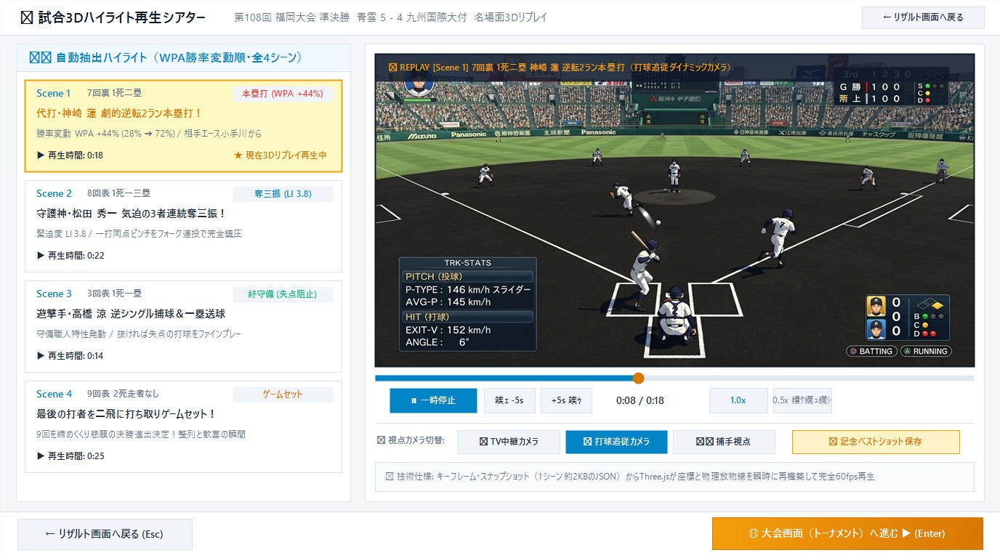

- **ビジュアル＆機能構成**:
  - **名場面クリップ一覧（左側）**: 試合中にWPA（勝利確率変動値）とLI（局面緊迫度）によって自動抽出された決定的シーン（本塁打、ピンチ脱出三振、ファインプレー、ゲームセット等）のカードリスト。
  - **3D再生ビューポート（右側）**: 実際の3D試合画面（内野俯瞰打球追従やTV中継超望遠）がそのままリプレイ画面として展開され、打球の美しい放物線や歓喜のガッツポーズを60fpsで完全リプレイ。
  - **プレイヤーコントローラー**: 再生/一時停止、±5秒シーク、0.5xスロー再生。
  - **カメラ視点切替 ＆ 撮影**: `[ 📹 TV中継カメラ ]` `[ 🎥 打球追従 ]` `[ 👁️ 捕手目線 ]` `[ 📸 記念ベストショット保存 ]`。
  - **💡 「名場面」の定量的自動判定アルゴリズム**:
    - ① **WPA（Win Probability Added: 勝利確率変動値）**: 打席前後の自チーム勝率の変動量。神崎の2ラン本塁打（勝率28% ➜ 72%、WPA +44%）のような大逆転劇を最優先抽出。
    - ② **LI（Leverage Index: 局面緊迫度）**: 8回1死一三塁（LI 3.8）のような極限のピンチでの奪三振・凡退処理。
    - ③ **ドラマフラグ**: サヨナラ、逆転打、守備職人のファインプレー、ゲームセット。
  - **💡 技術的実現方式（キーフレーム・スナップショット）**: 重い動画ファイル（mp4等）を使わず、**打席開始時の選手座標・球種・打球初速ベクトル等をわずか2KB程度の軽量JSONで保持**。Three.jsでその瞬間を瞬時に再構築して再生するため、**ロード時間0秒・メモリ消費ほぼゼロ・アングル自由**という極めて洗練されたアーキテクチャを実現。
  ※詳細仕様は [試合結果・詳細ボックススコア＆3Dハイライト仕様書（match_result_and_highlights_specification.md）](./match_result_and_highlights_specification.md) を参照。

---

## 6. 技術スタック・描画 ＆ サーバーレス・アーキテクチャ設計

Web（ブラウザ環境）で最高峰の演出・快適な動作、および**サーバー維持費0円（Firebase無料枠）**を両立するため、**「Three.jsセルルック3D ＋ TypeScriptクライアント高速実行」×「Firebase BaaS ＋ Stripe決済」**の完全サーバーレス・ハイブリッド構成を採用します。

### 6.1 各レイヤーの技術選定
| レイヤー | 採用技術 | 役割・選定理由 |
| :--- | :--- | :--- |
| **試合3Dレンダリング** | Three.js (WebGL) + セルシェーダー | ブラウザで60fpsで軽量動作。TV中継の超望遠から打球現場への瞬時クローズアップまで全方向カメラワークを自在に実現。 |
| **3Dモデル＆モーション** | ロー/ミドルポリglTF + クリップアニメーション | 4大体型モデル（スラッガー、アスリート、捕手、ルーキー）。全国4,000校のユニフォーム・背番号をプログラムから瞬時に差し替え可能。 |
| **2D UI・画面描画** | HTML5 / Modern CSS / WebP | 選手一覧、オーダー編成（D&D対応）、選手交代、戦力レーダーチャート等を高精細かつ直感的に描画。 |
| **ゲームコア・シミュレーション** | TypeScript (Vite) / Web Worker | 打球物理演算、9人守備AI、走塁判定、確率計算、育成日程進行をすべて**ブラウザ上でミリ秒実行**。1球ごとの通信が不要なため遅延ゼロ・オフライン対応。 |
| **インフラ ＆ BaaS** | Firebase (Hosting / Firestore / Auth) | **Sparkプラン（無料枠）を最大活用**。CDN配信（10GB/月）、セーブデータ同期（読込5万回/書込2万回/日）、匿名認証（即プレイ可能）を0円で運用。 |
| **課金・決済基盤** | Stripe ＋ Firebase Webhook | クレジットカード、Apple Pay、Google Pay対応。安全なWebhook経由でFirestoreへチケット・コスメ付与。決済手数料（約3.6%）以外のサーバー固定費は実質0円。 |

---

### 6.2 システム構成図（クライアント完結 ＋ Firebase BaaS）

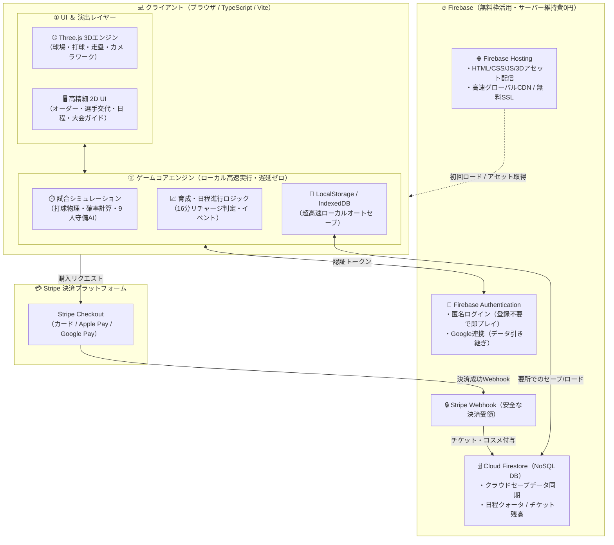

---

### 6.3 サーバーレス・データ構造 ＆ 課金・クォータ設計

#### 6.3.1 日程進行クォータ仕様（ソシャゲ型B方式：常時リチャージ）
プレイヤーの離脱を防ぎ、毎日定期的にログインしてチームの成長を見守る楽しさを提供するため、**「ソシャゲ型常時リチャージ方式」**を採用します。

- **最大保有枠**: **90日分**（ゲーム内時間で約3ヶ月＝高校野球の1シーズン／1四半期分）。**自然回復・無料チケットは90日を超えて溜まらない**。**お金を出して購入した課金チケットを使った場合のみ、90日の上限を突破してチャージ可能**（例: 残り80日で課金チケットを使うと170日）。
- **回復ペース**: **「16分経過ごとに 1日分 自然回復」**（16分 × 90日 ＝ ちょうど24時間で全快）
- **プレイスタイルの最適化**:
  - 朝に春大会（約40日分）を一気にプレイ ➜ 昼休みに自然回復分（約19日分）で練習試合 ➜ 夜の帰宅後に自然回復分（約28日分）で夏の大会に挑戦！
  - 「スタミナが溢れるのがもったいない」心理が自然に働き、毎日の継続プレイ率（DAU）が飛躍的に向上。
- **枠を使い切った場合の選択肢**:
  - 自然回復（16分で1日）を待つ。
  - ゲーム内実績で獲得した「チケット」を使用する。
  - Stripe決済で「日程進行チケット」を購入する。

#### 6.3.2 チケット経済圏 ＆ Pay to Win徹底排除の哲学
本作の課金システムは、**「Pay to Win（課金で選手の強さが決まる）を徹底的に排除」**し、**「ゲームの進行時間の短縮」**および**「純粋なこだわり・自己表現（コスメティック）」**のみにチケットを使用するクリーンで健全なモデルを採用します。

| 商品ラインナップ | 価格（税込） | 内容・効果 |
| :--- | :--- | :--- |
| **青雲チケット (1枚)** | **120円** | ゲーム内日程を **+90日分** 即時チャージ。**課金チケットは90日の上限を突破可能**（またはこだわりコスメと交換）。ゲーム内実績で配布される無料チケットは上限90日まで。 |
| **お得なチケットパック (5枚組)** | **480円** (1枚あたり96円) | まとめ買い用のお得なパック |
| **【買い切り】永久フリーパス** | **1,480円** | 日程進行制限を**永久に完全撤廃（UNLIMITED）** |

#### 6.3.3 こだわり要素（コスメティック）の解放ラインナップ
チケットを通貨として消費することで、強さには一切影響しない「高校野球ファン垂涎のこだわり要素」を自由にアンロックできます。

1. **限定ユニフォーム・スタイル**:
   - 名門伝統の縦縞（ピンストライプ）ユニフォーム
   - 昭和レトロ・開襟クラシックスタイル
   - 甲子園名門校風カラー（エンジ、濃紺、サックスブルー）
   - 胸ロゴ・背番号フォント（オールドイングリッシュ、クラシック筆記体、漢字ブロック体）
2. **甲子園ブラスバンド応援曲パック**:
   - チャンス時の大迫力ブラバン演奏（アフリカン風、ファンファーレ等）
   - 重厚な魔曲風応援BGM、得点時の歓喜ジングル
3. **球場演出・スコアボードスキン**:
   - 昭和の木製手書き名札スコアボード演出
   - 甲子園伝統の開会・閉会サイレン音（高音質リマスター版）
4. **監督アバター ＆ 名将称号**:
   - 監督ビジュアル（白シャツ腕まくり、ユニフォーム姿、昭和の名将風サングラス）
   - 大会ガイドに輝く称号（「不屈の雑草軍団」「名門の再建人」など）

※ゲーム内実績（甲子園初出場、通算50勝など）でもチケットが無料配布されるため、**無課金プレイヤーでも努力次第でお気に入りのユニフォームを獲得可能**です。

#### 6.3.4 Firestoreデータモデル ＆ 無料枠（Spark/Blaze）最適化設計
Firestoreの無料枠（読込50,000回/日、書込20,000回/日）を確実に守り、コスト0円で運用するための最適化設計です。

- **毎球・毎画面の通信を完全排除**:
  - 通常プレイ中はブラウザの「IndexedDB / LocalStorage」に超高速ローカルオートセーブ。
  - **「月送り完了時」「試合終了時」「チケット消費時」「明示的セーブ時」にのみFirestoreへ非同期書き込み**。
  - 1人あたりの書き込みは1プレイで数回〜十数回に抑えられるため、1日数百〜数千人がプレイしても無料枠（2万回/日）を大きく下回ります。

```json
// users/{uid}/profile（ユーザー基本情報・クォータ・コスメ）
{
  "userId": "usr_abc123",
  "paidTickets": 3,                       // 課金チケット数（使用時に上限90日を突破可）
  "freeTickets": 2,                       // 無料チケット数（実績配布。使用しても上限90日）
  "currentQuotaDays": 75,                 // 現在の残り可能日数 (0〜90)
  "lastRechargeTimestamp": 1729500000,   // 前回16分計算サーバー時刻
  "isUnlimitedPass": false,               // 永久フリーパス
  "unlockedCosmetics": [                  // 解放済みアイテムID一覧
    "uniform_classic_pinstripe",
    "brass_pack_chance_vol1",
    "scoreboard_retro_wood"
  ],
  "equippedCosmetics": {                  // 現在セット中のアイテム
    "uniform": "uniform_classic_pinstripe",
    "brassBgm": "brass_pack_chance_vol1",
    "scoreboard": "scoreboard_retro_wood"
  }
}

// users/{uid}/saveData/current（現在のチーム育成データ）
{
  "schoolName": "青雲",
  "prefecture": "福岡",
  "gameDate": "2026-07-15",
  "funds": 1250000,
  "facilityLevels": { "ground": 3, "battingCage": 2, "gym": 2 },
  "roster": [ /* 選手パラメータ（能力・特殊能力・調子等） */ ],
  "regularOrder": [ /* 1〜9番スタメン配置 */ ]
}
```

---

## 7. 今後の開発・実装ステップ ＆ 将来検討論点

### 7.1 本基本設計完了に基づく開発実装ステップ
1. **フェーズ1（コアエンジン実装）**:
   - TypeScriptゲームループ（`GrowthEngine`, `FatigueProcessor`, `TournamentGenerator`）
   - Three.js 3D球場・打球・カメラワーク描画基盤
2. **フェーズ2（UI ＆ マネジメント画面実装）**:
   - メインダッシュボード（カンバン練習、オーダーD&D、選手一覧、ショップ）
   - 日程進行3ボタン（1日/1週間/1か月）およびAuto-Pause / Safety Stop
3. **フェーズ3（試合進行・結果・ハイライト実装）**:
   - 1球采配・リアル作戦コマンド・投球打球演出
   - 白基調公式スコアカード、詳細ボックススコア、3Dハイライト（WPA/LI判定・2KB JSON）
4. **フェーズ4（インフラ・課金・データ連携）**:
   - Firebase無料枠（Hosting / Firestore / Auth）連携
   - Stripe決済 Webhook 連携（チケット経済圏・永久パス）

### 7.2 将来のアップデート検討論点
1. **非同期オンライン対戦（他校挑戦機能）**:
   - Firestoreの公開コレクション（`public/sharedTeams`）を介して、全国のプレイヤーが育てたチームと練習試合ができる非同期対戦機能の設計検討
2. **大会ガイドHTMLエクスポートのSNSシェア機能**:
   - 自分のチームの戦力やドラフト注目選手を含む大会展望HTMLを画像/リンク化してSNSで共有する機能


