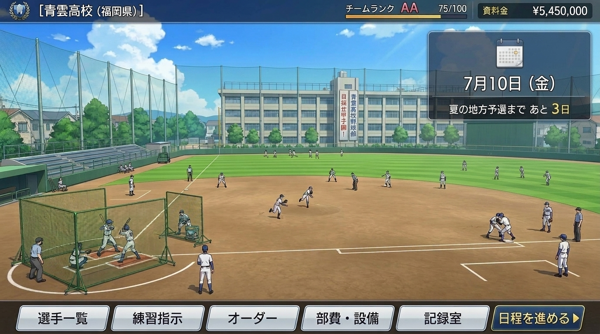
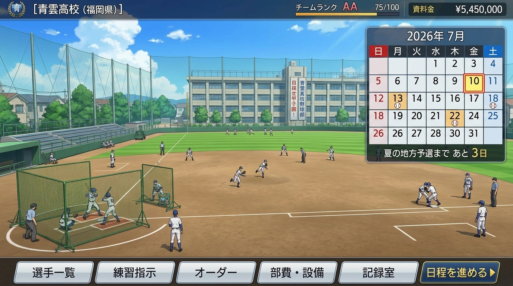
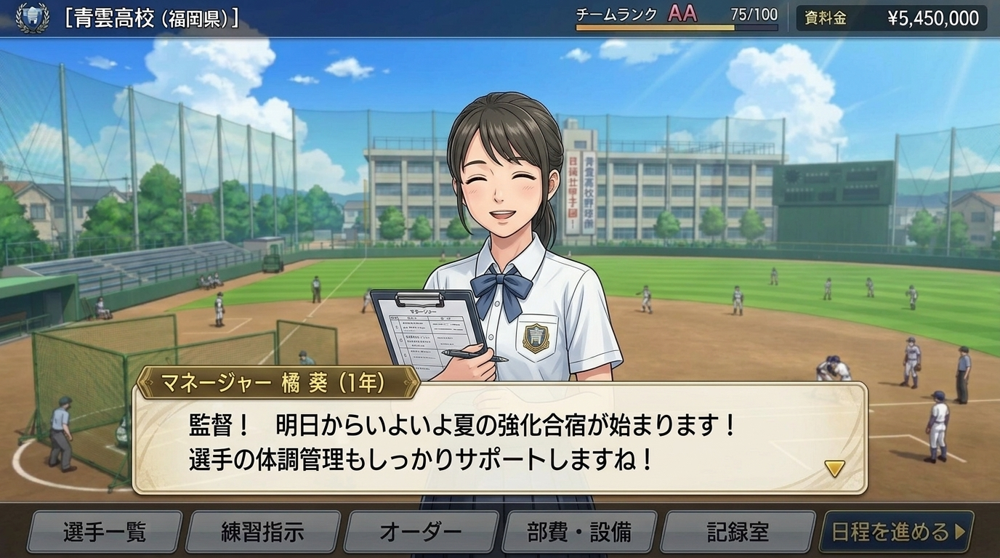

# 高校野球シミュレーション5 (KokoSim 5)
## 通常画面仕様書：メイン画面（ホームダッシュボード）

---

## 1. 画面概要とコンセプト

メイン画面は、プレイヤー（監督）が部員たちの成長を見守り、日々の練習指示やチーム運営を行う**活動の拠点（ホームダッシュボード）**です。  
高校野球の青春の空気感を伝えるため、**「校舎が見える自校グラウンドでの練習風景」**をメインビジュアルとして採用し、監督が設定した練習メニューやチームの実績（甲子園出場など）がダイナミックにグラウンド上に反映されます。

#### 【平常時（デフォルト表示：コンパクトカレンダー）】
通常時はグラウンドの開放感を損なわないよう、右上のカレンダーは半分のサイズで控えめに表示されます。


#### 【マウスホバー時（月間カレンダーグリッド展開）】
マウスカーソルをカレンダーに乗せると（ホバー時）、部室の予定表のような月間マンスリーグリッドがスムーズに展開し、大会日程や試合アイコン（⚾）を確認できます。


### 主な特徴
1. **情緒ある校舎＆グラウンドアングル**:
   - 奥に3階建ての高校校舎、手前に黒土と緑の外野芝生が広がる高校野球の原風景。
2. **校舎の「垂れ幕ギミック」**:
   - 甲子園出場や地方大会優勝など、チームの実績に応じて校舎壁面に掲げられる垂れ幕が動的に変化。
3. **練習メニュー連動の選手アニメーション**:
   - 監督が「練習指示」で設定した練習内容（フリー打撃、シートノック、ランニング等）に応じて、グラウンド上の3Dミニ選手たちが生き生きと練習をこなします。
4. **邪魔にならない右上カレンダー**:
   - 日付と次の公式戦・練習試合までのカウントダウンを視認性高くコンパクトに常時表示。
5. **画面下部固定の主要機能ナビゲーション**:
   - 片手またはワンクリックで「選手一覧」「練習指示」「オーダー」「設備・ショップ」「記録室」「日程進行」へストレスなく遷移可能。

---

## 2. 画面UIレイアウト構成

```
+-----------------------------------------------------------------------------------+
| [校章] [青雲高校 (福岡県)]       チーム名声: [強豪 (Rank A)]   部費: ¥25,480,000   | [ 7月10日 (金) ] [⚙] |
|                                                                                   | 夏の地方予選まで あと 3日 |
+-----------------------------------------------------------------------------------+
|                                                                                   |
|                                [ 奥の校舎 ]                                        |
|                     ┌───────────────────────────────┐                            |
|                     │ 垂れ幕: 「目指せ甲子園！ 青雲高校野球部」│                            |
|                     └───────────────────────────────┘                            |
|                                                                                   |
|                                                                                   |
|                                                               [ 2026年 7月 ]       |
|                                                               日 月 火 水 木 金 土 |
|                                                                1  2  3  4  5  6  7 |
|                                                                8  9 [10] 11 12 ⚾ 14|
|                                                               夏の地方予選まであと3日 |
|         [ 練習風景: バッティングケージ ]        [ 練習風景: 内野シートノック ]        |
|             (打撃練習・トスバッティング)               (ノッカー・投内連携)             |
|                                                                                   |
|                                                                                   |
|                                                [ 練習風景: 外野ランニング ]        |
+-----------------------------------------------------------------------------------+
| [ 👤 選手一覧 ] [ 📋 練習指示 ] [ ⚾ オーダー ] [ 📦 部費・設備 ] [ 📜 記録室 ] | [ 日程を進める ▶ ] |
+-----------------------------------------------------------------------------------+
```

---

## 3. 各UIエリア詳細仕様

### 3.1 画面上部：学校情報ヘッダー
常にプレイヤーの高校の所属・規模・資金状況を表示します。

| 表示項目 | 内容 | 備考 |
| :--- | :--- | :--- |
| **校章・学校名・県名** | `[青雲高校 (福岡県)]` | 全国の高校データから選択した自校情報 |
| **チーム名声・ランク** | `[Rank AA (強豪)]` | 弱小 / そこそこ / 中堅 / 強豪 / 名門 の5段階 |
| **部費（部活動予算）** | `¥5,450,000` | 備品購入、遠征費、グラウンド整備等に使用する活動資金 |

### 3.2 画面右上：カレンダーウィジェット（ホバー展開型）
画面の視界と開放感を邪魔しないよう、**デフォルトでは半分のコンパクトサイズ**で表示され、**マウスカーソルが乗ると滑らかに月間カレンダーグリッドへ拡大展開**するインタラクティブUIを採用します。

#### ① デフォルト状態（非アクティブ時：半分のサイズ）
- **表示サイズ**: 幅 約180px × 高さ 約90px（省スペース表示）
- **表示項目**:
  - アイコン：小さなカレンダーアイコン 📅
  - 日時：`7月10日 (金)`
  - カウントダウン：`夏の地方予選まで あと 3日`
- **目的**: グラウンドの青空・校舎・練習風景を遮らず、必要な日程情報だけをコンパクトに常時表示。

#### ② マウスホバー時（アクティブ時：月間カレンダーグリッドへスムーズ拡大）
- **動作仕様**:
  - カーソルがウィジェット領域に入ると、`transition: all 0.25s cubic-bezier(0.16, 1, 0.3, 1)` でスムーズに拡大。
  - 幅 約340px × 高さ 約300px の本格マンスリーカレンダーカードとしてポップオーバー展開。
  - カーソルが外れると、自然にデフォルトのコンパクトサイズへフェード縮小。
  - ※スマートフォン・タブレットなどのタッチ端末では、タップで展開／画面外タップで閉じるトグル動作に対応。
- **展開時の表示項目**:
  | 表示項目 | 内容 | 備考 |
  | :--- | :--- | :--- |
  | **年・月表示** | `2026年 7月` | ヘッダーに明快に表示 |
  | **曜日ヘッダー** | `日 月 火 水 木 金 土` | 日曜＝赤、土曜＝青 |
  | **日付マス目グリッド** | `1日 〜 31日` | 7×5マスの月間グリッド |
  | **現在日付枠** | `10日 (赤/黄の二重枠)` | 本日の位置を視覚的に強調 |
  | **予定・試合バッジ** | `⚾ 試合マーク` / `📝 テスト` | 公式戦開幕（7/13等）や練習試合の予定日アイコン |
  | **直近目標カウントダウン帯** | `夏の地方予選まで あと 3日` | 下部に帯状配置 |

### 3.3 画面中央：グラウンド＆校舎（動的ビジュアルエリア）

#### ① 練習メニュー連動演出
監督が「練習指示」で設定した練習グループの内容に応じて、グラウンドの各エリアに選手キャラが配置されアニメーションを実行します。

| 練習種別 | グラウンド上の演出 |
| :--- | :--- |
| **打撃系（フリー打撃、マシン打撃）** | ホームベース付近にバッティングゲージを設置。投球マシンまたは打撃投手の球を打ち返す。 |
| **守備系（シートノック、特守）** | 監督・コーチがノックバットを持ち、内野手（遊撃・二塁等）が打球を捕球して一塁へ送球。 |
| **バッテリー系（ブルペン投球）** | マウンドまたはブルペンで投手が投球練習、捕手が構えてキャッチング。 |
| **体力づくり（ランニング、ダッシュ）** | 外野フェンス沿いやファウルグラウンドを部員たちが掛け声をかけて周回ランニング。 |
| **休養・ミーティング** | ベンチ周辺で選手たちがリラックスして水分補給やストレッチを行っている風景。 |

#### ② 校舎の垂れ幕ギミック
公式戦の戦績やイベントに応じて、奥の校舎壁面に巨大な垂れ幕が掲示されます。

| 達成状況 | 垂れ幕テキスト | 特殊演出 |
| :--- | :--- | :--- |
| **通常期間** | `「目指せ甲子園！ ○○高校野球部」` | 通常グラウンド風景 |
| **地方大会 決勝進出** | `「祝 福岡大会決勝進出！ 頂点へ！」` | 校門付近に応援ののぼり旗 |
| **甲子園出場決定** | `「祝 第108回全国高校野球選手権大会出場！」` | 垂れ幕にゴールドの装飾リボン、紙吹雪 |
| **甲子園 ベスト4〜準優勝** | `「祝 甲子園ベスト4進出！ 感動をありがとう」` | 地元住民・ファンの見学者が増加 |
| **甲子園 優勝（全国制覇）** | `「祝 甲子園初優勝！ 全国制覇達成！」` | 特大の金文字垂れ幕、深紅の大優勝旗グラフィック |

#### ③ 季節・天候・時間帯の動的レンダリング
- **季節**:
  - 春（4月〜5月）：校舎脇の桜が満開、新入生入部イベント。
  - 夏（6月〜8月）：青く澄み渡る空と入道雲、強い日差し。大会前の緊張感。
  - 秋（9月〜11月）：新チーム発足、秋の夕暮れのノスタルジックなオレンジ色の光。
  - 冬（12月〜2月）：冷え込むグラウンド、長袖グラコン着用、基礎体力トレーニング中心。
- **天候**:
  - 晴天（通常練習） / 雨天（グラウンドに水たまり、室内練習場・校舎内筋トレへ自動遷移）。

---

## 4. イベント発生時の演出・UI仕様（マネージャー大写し＆ダイアログ）

日程進行中、または特定の日付を迎えた際に発生するイベント演出仕様です。



### 4.1 イベントの種類
1. **ランダムイベント**:
   - 日程進行中に確率で発生。
   - 例: 部費の臨時支援、選手の軽傷・故障、OB/保護者会からの差し入れ（ドリンク・プロテイン）、プロ球団スカウトの視察、部員の成長期（能力微増）など。
2. **定期イベント**:
   - 年間スケジュールに基づき、特定の日時・大会前後に発生。
   - 例: 新入生入部（4月）、春季大会、体育祭、夏の強化合宿（7月）、ドラフト会議（10月）、定期試験（勉強不足で練習制限）、卒業式（3月）など。

### 4.2 画面レイアウトと演出
- **背景（グラウンド・校舎）**:
  - メイン画面のグラウンド背景を維持しつつ、手前を強調するため、わずかな被写界深度（ソフトフォーカス・ブラー）および薄い黒オーバーレイ（暗転率約15%）を適用。
- **マネージャーの大写し（2D立ち絵キャラクター）**:
  - **画面中央〜右寄り**にバストアップ〜腰上の大写しで配置。
  - **3年ごとのマネージャー選抜ギミック**:
    - 3年に一度、新入生から女子マネージャーを選択（複数人の候補からプレイヤーが選択可能。性格・得意サポート分野・ビジュアルが異なる）。
  - **豊富な表情差分**:
    - 通常笑顔、喜怒哀楽、心配顔、驚き、真剣顔など、イベント内容に応じてリアルタイムに表情が切り替わる。
- **イベントメッセージウィンドウ（画面下部ADVダイアログ）**:
  - **話者ネームプレート**: `[マネージャー 橘 葵 (1年)]`（肩書・氏名・学年を表示）
  - **メッセージテキスト**: イベントの状況説明やセリフを明朝/丸ゴシックのクリーンなフォントで表示。
  - **次へ進むプロンプト（▽）**: 画面タップまたはクリックで次のメッセージへ進行、あるいはイベント完了でメイン画面へスムーズに復帰。

---

## 5. 画面下部：固定ナビゲーションバー（フッターメニュー）

画面最下部には、どの画面からも直感的に目的の機能へアクセスできる固定タブバーを配置します。

| ボタン名 | アイコン | 遷移先画面 | 主な機能 |
| :--- | :---: | :--- | :--- |
| **選手一覧** | 👤 | 選手詳細リスト | 全部員の能力値、適性、コンディション、特殊能力、学年別ソート |
| **練習指示** | 📋 | 練習設定画面 | 全体・ポジション別・個人メニュー割当、機材使用、練習方針 |
| **オーダー** | ⚾ | 打順・守備配置画面 | スタメン・打順（1〜9番）、守備位置、背番号割り当て、代打設定 |
| **部費・設備** | 📦 | ショップ・購買部 | ピッチングマシン等の練習機材購入、グラウンド整備、栄養サプリ |
| **記録室** | 📜 | データベース画面 | 歴代戦績、個人通算記録、甲子園優勝記念館、全国高校検索 |
| **日程を進める ▶** | ⏩ | 日程進行コントロール | `[1日進める]` `[1週間進める]` `[1か月進める]` の3ボタンで進行（試合・重要行事・クォータ切れで自動安全停止） |

---

## 6. 技術仕様とレンダリング方式

- **ハイブリッド描画アーキテクチャ**:
  - **背景（校舎・青空・周辺環境）**: 高精細な2.5Dレイヤードイラスト。天候・季節・垂れ幕の切り替えをスプライト／シェーダーで高速制御。
  - **グラウンド・選手**: Three.js による軽量セルルック3Dミニキャラ。練習指示データ（DB: `PracticePlan`）とバインドし、指定されたアニメーションクリップをループ再生。
  - **UIオーバーレイ**: Tailwind CSS / HTML5 + React (または Vue) によるレスポンシブHTMLレイヤー。PC/スマホ/タブレット問わず16:9比率を基準にスケール。
  - **イベントレイヤー**: z-index最上位にマネージャー立ち絵スプライトとメッセージダイアログをマウントし、CSSトランジション（フェードイン・スライド）で展開。
- **パフォーマンス最適化**:
  - メイン画面は長時間放置されることが多いため、ウィンドウ非アクティブ時はフレームレートを15fpsに抑制する省電力モードを搭載。
