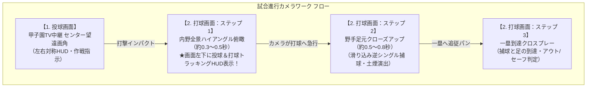

# KokoSim 5 試合画面・カメラワーク仕様書（旧ドラフト）

> [!WARNING]
> **本ドキュメントは初期検討ドラフトです（統合済み）**  
> 3D試合進行、作戦采配コマンド、1球采配テンポ、Auto-Pause、および試合結果・3Dハイライトの最新確定仕様は、以下の最新ドキュメントを参照してください：
> - [3D試合・リアルタイム作戦采配システム詳細仕様書（match_system_specification.md）](./match_system_specification.md)
> - [試合前オーダー・試合中選手交代詳細仕様書（match_order_and_substitution_specification.md）](./match_order_and_substitution_specification.md)
> - [試合結果・詳細ボックススコア＆3Dハイライトシステム詳細仕様書（match_result_and_highlights_specification.md）](./match_result_and_highlights_specification.md)
> - [基本設計書（kokosim5_design_document.md）](./kokosim5_design_document.md)

**文書バージョン**: 2.1.0（旧版）  
**更新日**: 2026年10月8日  

---

## 1. 試合画面の全体コンセプト

本作の試合画面は、テレビの高校野球中継が持つ**「圧倒的なスケール感・戦況把握のしやすさ」**と、ゲームならではの**「スーパープレーの迫力・ドラマチックなカメラワーク」**を高い次元で融合させたハイブリッド3D演出を採用します。



---

## 2. 投球画面（TV中継画角：Pitch Broadcast View）

高校野球の聖地・**阪神甲子園球場**でのTV中継画角を完全再現したメイン画面です。


### 2.1 画面UI・HUDレイアウト（確定仕様）
- **左側（投手パネル）**: 帽子顔アイコン、`ERA: 1.85`、`Pitches: 85`、**横長スタミナゲージバー（緑→黄→赤）**
- **右側（打者パネル）**: ヘルメット顔アイコン、通算成績（`AVG: .280`、`HR: 2`）、**直下に1打席ごとの打席結果カラータイル（青＝凡退、赤＝安打）**
- **上部中央**: TV中継スコアボード（イニング、得点、BSO、1・2塁走者点灯）
- **左下**: 守備配置ミニマップ ＆ **「通常シフト」**等の守備体系ラベル
- **右下**: 画面を遮らないスマートな単一**「作戦」ボタン**（クリックで作戦ドロワー展開）

---

## 3. 打球画面（動的クローズアップ＆トラッキングデータHUD）

バットがボールを捉えた瞬間、カメラは以下の2段階でダイナミックに遷移し、最新のトラッキングデータを表示します。

---

### 3.1 【ステップ1】打った直後：内野全景ハイアングル ＆ トラッキングHUD（約0.3〜0.5秒）

打球がどこへ飛んだかを一瞬で全体把握しつつ、**画面左下にリアルタイムの投球＆打球解析データ（Statcast仕様）**を表示します。


#### 画面左下：投球＆打球トラッキングHUD（TRK-STATS）
物理演算エンジン（決定論的物理モデル）が算出したリアルな数値を瞬時にオーバーレイ表示します：

```text
┌────────────── TRK-STATS ──────────────┐
│ PITCH (投球)                         │
│ P-TYPE: 146 km/h スライダー          │
│ AVG-P: 145 km/h                      │
│                                      │
│ HIT (打球)                           │
│ EXIT-V: 152 km/h  (打球速度)         │
│ ANGLE: 6°         (打球角度)         │
└──────────────────────────────────────┘
```

- **投球データ**:
  - `投球スピード`: `146 km/h`
  - `球種`: `スライダー`（ストレート、フォーク、カーブ等）
- **打球データ（バッター）**:
  - `打球速度 (Exit Velocity)`: `152 km/h`（プロ・強豪高校生の痛烈な初速）
  - `打球角度 (Launch Angle)`: `6°`（強烈なゴロ）、`25°〜30°`（本塁打性のバックスピンライナー）等
- **プレイヤーへの効果**:
  - 「今のは甘いスライダーを完璧な角度で捉えた！」「詰まらされたが打球速度が速くて内野を抜けた！」など、バットの芯で捉えた手応えを数値と弾道でリアルに実感できます。

---

### 3.2 【ステップ2】捕球の瞬間：寄りの映像（現場クローズアップ：約0.5〜0.8秒）

打球が野手の守備位置に達した瞬間、カメラが野手の足元へ急行ズームイン＆パンし、**至近距離でスーパープレーの迫力**を演出します。


- **3Dカメラ仕様（Three.js）**:
  - 位置：遊撃手の進行方向斜め前ローアングル（$Z \approx 0.8\text{m} \sim 1.2\text{m}$ 地面スレスレ）
- **ビジュアル・演出の特徴**:
  - ショート（背番号6）が黒土を巻き上げながら低く滑り込み、逆シングルでグラブを差し出す迫真のアクション。
  - 砂煙エフェクトやスピード線（集中線）のエフェクト、「DRAMATIC PLAY! SHORTSTOP [6]」のテロップ。

---

### 3.3 【ステップ3】一塁到達クロスプレー＆判定
カメラが一塁ベース上へ瞬時にパンし、一塁手の捕球と打者走者の足の駆け抜けを至近距離で捉えてアウト/セーフを判定コールします。

---

## 4. カメラワーク設定機能（プレイヤー選択）

| モード名 | 特徴・カメラ挙動 | 推奨プレイスタイル |
| :--- | :--- | :--- |
| **① ダイナミック演出（推奨・デフォルト）** | **【内野ハイアングル俯瞰（トラッキング表示） → 野手寄りクローズアップ → 一塁クロスプレー】とカットが切り替わる迫力重視モード**。 | 試合の臨場感・ドラマを存分に楽しみたいプレイヤー |
| **② 中継固定（クラシック視点）** | **ハイアングル俯瞰のままカメラがスムーズにパンし、全体を見渡し続けるモード**。 | 戦況全体を落ち着いて見渡したい戦略派プレイヤー |
| **③ シンプル / 高速スキップ** | **カメラ移動や演出を最小限にし、テンポを最優先にするモード**。 | サクサクと試合を進めて選手を育てたい育成周回プレイヤー |
