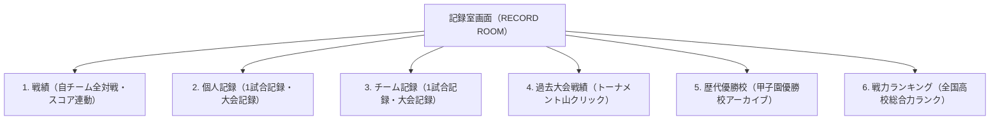

# 高校野球シミュレーション5（KokoSim 5）通常画面仕様書：記録室画面

**文書バージョン**: 1.0.0  
**作成日**: 2026年10月20日  
**ステータス**: 初版確定ドラフト  
**対象画面**: 記録室画面（レコードルーム）

---

## 1. 画面概要・コンセプト

記録室画面は、プレイヤーが自チームの歴史（これまでの全対戦戦績・名勝負・スコアボード）を振り返り、大会ごとの個人・チームレコードを称え、さらに全国47都道府県の地方予選トーナメントや甲子園大会の全対戦結果、歴代優勝校、全国戦力ランキングを閲覧・分析できる「野球部の総合アーカイブセンター」です。



---

## 2. 画面レイアウト構成（1376 × 768 px）

画面は以下の5つのエリアで構成されます。

```
+----------------------------------------------------------------------------------------------------+
| 1. 上部ヘッダーバー: タイトル / 学校名 / 通算戦績サマリー / 甲子園実績                             |
+----------------------------------------------------------------------------------------------------+
| 2. 6大タブバー: [戦績] [個人記録] [チーム記録] [過去大会戦績] [歴代優勝校] [戦力ランキング]       |
+----------------------------------------------------------------------------------------------------+
| 3. コントロールバー: 絞り込みフィルター (すべて / 公式戦 / 甲子園 / 練習試合) / ソート状態表示   |
+----------------------------------------------------------------------------------------------------+
| 4. メインコンテンツエリア (2ペイン構成)                                                            |
|  +-------------------------------------------------+  +-----------------------------------------+  |
|  | 【左ペイン】自チーム戦績一覧テーブル            |  | 【右ペイン】行クリック連動              |  |
|  |  No ▲▼ | 大会名 ▲▼ | スコア ▲▼ | 日付 ▲▼   |  |   スコアボード詳細パネル                |  |
|  | ----------------------------------------------- |  |  - 9回本格スコアボード (R/H/E)          |  |
|  |  142  | 夏の甲子園 準決勝 | ○ 5-3 vs横浜 | 8/21 |  |  - 責任投手・バッテリー・本塁打         |  |
|  |  141  | 夏の甲子園 準々決 | ○ 7-4 vs星稜 | 8/19 |  |  - 主要選手打撃スタッツ                 |  |
|  |  140  | 夏の甲子園 3回戦  | ○ 4-2 vs智弁 | 8/16 |  |  - 監督戦評・ハイライト                 |  |
|  |  ... (最新の試合が一番上・ソート可能)           |  |  - [全打席スコアブック] [ハイライト再生]|  |
|  +-------------------------------------------------+  +-----------------------------------------+  |
+----------------------------------------------------------------------------------------------------+
| 5. 固定ボトムナビゲーションバー: [メイン] [選手一覧] [練習指示] [オーダー] [部費・設備] [記録室(点灯)] |
+----------------------------------------------------------------------------------------------------+
```

### 画面イメージ


---

## 3. 各タブの詳細仕様

### 3.1 「戦績」タブ（デフォルト表示）
自チームのこれまでの全試合（公式大会＋練習試合）の軌跡を完全記録します。

1. **一覧テーブルの仕様**:
   - **並び順**: **最新の試合が一番上（日付降順がデフォルト）**。
   - **列項目とソート**:
     - `「No」`: 通算試合番号（No.1〜最新）。昇順・降順ソート可能（▲▼）。
     - `「大会名」`: 大会・フェーズ名（例: 夏の甲子園 準決勝、福岡大会 決勝、練習試合 等）。50音順ソート可能（▲▼）。
     - `「スコア（対戦相手）」`: 勝敗バッジ（○勝、●敗、△分）、自校得点 - 相手得点、対戦校名（都道府県名）。得点差順・勝敗順ソート可能（▲▼）。
     - `「日付」`: 試合実施日（YYYY/MM/DD）。日付順ソート可能（▲▼）。
   - **フィルタ切り替え**:
     - `[すべて (142)]`
     - `[公式戦のみ (86)]`
     - `[甲子園のみ (18)]`
     - `[練習試合のみ (56)]`
2. **行クリック連動スコアボード詳細（右ペイン）**:
   - テーブル内の任意の試合行をクリックすると、その行がゴールド枠でアクティブハイライトされ、右ペインに該当試合のスコアボードが即座に表示されます。
   - **表示内容**:
     - **試合概要**: 日時、球場名（阪神甲子園球場、県営球場等）、天候、観客数。
     - **9イニング本格スコアボード**: 1〜9回（延長回対応）の各イニング得点、総得点（R）、総安打数（H）、失策数（E）。
     - **責任投手・バッテリー**: 勝利投手、敗戦投手、セーブ投手、投球数、被安打、奪三振、四死球、自責点、バッテリー構成。
     - **本塁打**: 打者名、号数、イニング、ランナー状況（ソロ/2ラン/3ラン/満塁）。
     - **ピックアップ打撃成績**: 当該試合のキーマンとなった部員の打撃スタッツ（打数、安打、打点、特記事項）。
     - **監督戦評＆試合ハイライト**: 試合の決定打、好守、勝因・反省点をまとめた戦評テキスト。
     - **アクションボタン**: `[全打席スコアブックを開く]`、`[試合ハイライトを再生]`。

---

### 3.2 「個人記録」タブ
これまで実施された**全公式大会（練習試合は除く）における個人の栄誉記録**を展示します。


- **切り替えサブタブ**:
  - `「★ 1試合 個人記録」`（選択中）:
    - **打撃部門**:
      - 1試合最多本塁打: **3 本塁打**（逢坂 慶次 / 2025夏 甲子園2回戦 vs仙台育英）
      - 1試合最多打点: **8 打点**（逢坂 慶次 / 満塁弾含む2発）
      - 1試合最多安打: **5 安打**（早坂 隼人 / 5打数5安打の猛打賞）
      - 1試合最多盗塁: **4 盗塁**（五十嵐 翔 / 快足リードオフマン）
      - サイクル安打達成: **単・二・三・本**（逢坂 慶次 / 甲子園史上初）
      - 連続試合安打: **18 試合連続**（逢坂 慶次 / 1年秋〜2年夏）
    - **投手部門**:
      - 1試合最多奪三振: **19 奪三振**（神崎 晴樹 / 2025夏 福岡大会決勝 vs九国大付）
      - 完全試合（パーフェクト）達成: **27 人完全封殺**（神崎 晴樹 / 奪三振14）
      - 公式戦最速球速: **154 km/h**（神崎 晴樹 / 甲子園準決勝計測）
      - 連続イニング奪三振: **8 回連続**（神崎 晴樹 / 毎回の快投）
      - 大会最少失点（完投）: **0 失点完封**（神崎 晴樹 / 4安打シャットアウト）
  - `「🏆 大会・通算記録」`:
    - 通算最多本塁打ランキング（歴代OB含む自校通算ランキング）
    - 1大会最多本塁打（逢坂 慶次 6本 / 第107回選手権）
    - 大会最高打率（成瀬 翔 .625 / 16打数10安打）
    - 通算勝利数ランキング（歴代エース投手の通算勝利数）
    - 大会最多奪三振（神崎 晴樹 54奪三振 / 6試合）

---

### 3.3 「チーム記録」タブ
これまで実施された**全公式大会（練習試合は除く）におけるチーム全体の金字塔**を展示します。


- **切り替えサブタブ**:
  - `「★ 1試合 チーム記録」`（選択中）:
    - **攻撃・打撃部門**:
      - 1試合最多得点: **22 得点**（2024夏 福岡大会2回戦 vs筑紫南 22-1 7回コールド）
      - 1試合最多安打: **25 安打**（先発全員安打・長打11本・チーム打率.581）
      - 1試合最多本塁打: **5 本塁打**（2025秋 九州大会準々決勝 vs神村学園）
      - 1イニング最多得点: **11 得点**（2024秋 福岡大会準々決勝 4回裏・打者15人猛攻）
      - 1試合最多盗塁: **8 盗塁**（2025春 福岡大会1回戦 vs博多東 機動破壊野球）
      - 1試合最多長打数: **11 本**（2025夏 甲子園大会2回戦 vs仙台育英 8-3）
    - **投手・守備部門**:
      - 1試合最多奪三振: **19 奪三振**（神崎17K・逢坂2K / 2025夏 福岡大会決勝）
      - 1試合最少被安打: **0 被安打（ノーヒットノーラン）**（2025春 九州大会1回戦 vs延岡商 9回完封）
      - 連続イニング無失点: **34 回連続**（2025秋 九州大会1回戦〜明治神宮大会準決勝）
      - 1大会最少チーム失点: **3 失点**（2025夏 甲子園全6試合 防御率0.50で全国制覇）
      - 1試合最多併殺: **4 併殺**（2024夏 福岡大会準決勝 6-4-3 / 4-6-3）
      - 連続無失策試合: **7 試合連続**（2025秋季公式戦 計63イニング失策ゼロ・守備率1.000）
  - `「🏆 大会・シーズン記録」`
  - `「📈 通算・連続記録」`

---

### 3.4 「過去大会戦績」タブ（昔ながらの新聞風トーナメント表閲覧）
過去に開催された**すべての公式大会（春季都道府県大会、夏の選手権予選、秋季大会、センバツ、夏の甲子園）のトーナメント表（勝ち上がり）**を、**日刊スポーツや甲子園公式パンフレット等でおなじみの「昔ながらの新聞風トーナメント勝敗表」**のスタイルで完全再現・閲覧できます。


- **ビジュアル・レイアウトの特徴（新聞風クラシックスタイル＆シード校対応）**:
  - **シード校（1回戦不戦勝）の正統な新聞罫線**:
    - 第1シード〜第4シードなどのシード校（青雲、九国大付、西短大付、福大大濠）は、**1回戦をスキップして2回戦の垂直線（柱）までスーッと1本の水平線が直通（220px長）**します。
    - 「1回戦シード」などの冗長な文言は一切入れず、**罫線美だけでシードを語る正統派の新聞スタイル**を追求。
    - ノーシード校同士は1回戦で等幅（110px）の「コの字」の山を作って戦い、その勝者がシード校の待つ2回戦の合流柱へ進出する、**新聞そのままのリアルな段違い構造**を完全に再現。
  - **完全等間隔の幾何学的グリッド**:
    - 各ラウンドの水平幅（ΔX = 110px等幅）および学校の行間（41px）を厳密に計算し、アンバランスさを排除した美しい整列ツリー。
  - **左側に縦にズラリと並ぶ学校名一覧**:
    - 学校名、都道府県名が縦に1列に整然と並びます。自校（青雲高校）はゴールドの背景と赤枠で一目瞭然に強調。
  - **右へ伸びる罫線と「赤い太線」による勝ち上がり**:
    - 学校名から右へ向かって各ラウンド（1回戦 ➡ 2回戦 ➡ 準々決勝 ➡ 準決勝 ➡ 決勝 ➡ 優勝）の山が伸びます。
    - **勝者のラインは学校名起点から赤太線（2.2px）で完全水平接続**され、敗者のラインは「グレーの細線 (1.2px)」で分岐。自校がサヨナラ勝ちで甲子園を決める感動の赤線ツリー。
  - **山のスコア直接刻印**:
    - 各対戦の山（合流罫線）に「5 - 1」「4 - 3」「8 - 1 (7コ)」「3 - 2 (サヨナラ)」等のスコアがダイレクトに刻印。
  - **右端の甲子園出場決定（優勝校）フラッグ**:
    - 決勝の右端に「🏆 優勝（甲子園出場） 青雲高校（3年ぶり4回目）」の栄誉枠が表示されます。
- **トーナメント表インタラクション（山クリック連動）**:
  - **山（対戦のスコア・分岐点）をクリック**:
    - 左ペインのトーナメント表上の任意の山をクリックすると、選択した試合が発光し、**右ペインにその試合の「詳細スコアボード（9回表・責任投手・バッテリー・本塁打・戦評）」が即座に連動表示**されます。
    - 自校の試合だけでなく、**他校同士の試合も含めてすべての山をクリックして詳細スコアを閲覧可能**です。
- **大会選択セレクター**:
  - 年度（`[2026年度 ▼]`）、大会種別（`[夏の甲子園 (全国大会) ▼]`）、地域（地方大会選択時は全国47都道府県の全地方予選を網羅）。

---

### 3.5 「歴代優勝校」タブ
春の選抜高校野球（センバツ）および夏の全国高校野球選手権（夏の甲子園）の**歴代優勝校アーカイブ**です。


- **左ペイン：歴代全国大会（選手権・センバツ）優勝校一覧テーブル**:
  - 第107回選手権（2025夏・青雲高校全国制覇！）から過去大会までの完全アーカイブ。
  - 表示項目: `大会回数`、`開催年度`、`大会種別`、`優勝校（都道府県）`、`準優勝校（都道府県）`、`決勝戦スコア`、`大会MVP選手`。
  - 大会フィルタ: `[すべて]` `[夏の選手権]` `[春のセンバツ]` `[明治神宮大会]`。
- **右ペイン：全国制覇ランキング ＆ 都道府県別殿堂**:
  - 全国制覇回数トップ: 1位 中京大中京（7回）、2位 大阪桐蔭（6回）、3位 PL学園（4回）...。
  - 都道府県別甲子園優勝数: 1位 大阪府（14回）、2位 愛知県（8回）、3位 兵庫県（7回）... ★福岡県（5回・青雲含む）。
  - `[🏛️ 野球殿堂・自校記念館を開く]` アクションボタン完備。

---

### 3.6 「戦力ランキング」タブ
全国約4,000校の高校野球部を対象とした、**最新の全国戦力格付けランキング**です。


- **左ペイン：全国強豪ランキングテーブル**:
  - 1位 大阪桐蔭(S/96)、2位 仙台育英(S/95)、3位 広陵(S/94)、4位 横浜(A+/92)、**5位 青雲(自校・A+/91)**、6位 智弁和歌山...
  - 多面的ステータス: 投手力、打撃力、機動力、守備力、総合力メーターバー、前季比変動トレンド（▲UP, - STAY, ▼DOWN）。
  - 範囲切り替え: `[● 全国]` `[九州地区]` `[福岡県内]`。
  - ソート: `[総合力順]` `[投手力]` `[打撃力]` `[機動力]` `[守備力]`。
  - `[📍 自校位置へジャンプ (青雲: 5位)]` ボタン完備。
- **右ペイン：選択校スカウティング分析（大阪桐蔭 vs 自校青雲）**:
  - 大阪桐蔭高校（1位）のチーム方針、昨秋戦績（神宮優勝）、戦力パラメーター直接比較バーグラフ。
  - 警戒すべきキーマン: エース右腕・前田（最速152km/h）、4番一塁手・徳丸（通算44発）等のスカウティングレポート。
  - `[⚔️ 大阪桐蔭との仮想対戦シミュレーション実行]` ボタン完備。

---

## 4. データ構造設計（スキーマ定義例）

```typescript
// 試合記録データ
interface MatchRecord {
  matchId: string;
  matchNo: number;              // 通算試合番号 (No.142)
  tournamentId: string;         // 大会ID
  tournamentName: string;       // 大会名 (夏の甲子園 準決勝)
  isOfficial: boolean;          // 公式戦フラグ (falseは練習試合)
  isKoshien: boolean;           // 甲子園フラグ
  date: string;                 // 試合日 (2026-08-21)
  stadium: string;              // 球場名
  weather: 'sunny' | 'cloudy' | 'rainy';
  spectators: number;           // 観客数
  
  // スコアボード
  homeTeam: TeamScore;          // 後攻 (青雲高校)
  awayTeam: TeamScore;          // 先攻 (横浜高校)
  
  // バッテリー・投手成績
  pitcherStats: PitcherStat[];
  catcherNames: { home: string; away: string };
  homeRuns: HomeRunStat[];
  
  // 戦評・ハイライト
  recapText: string;
  keyPlayerStats: KeyPlayerStat[];
}

interface TeamScore {
  teamName: string;
  prefecture: string;
  innings: number[];            // [0, 0, 1, 0, 0, 3, 0, 1]
  totalRuns: number;            // 5
  totalHits: number;            // 9
  totalErrors: number;          // 0
  isWin: boolean;
}
```

---

## 5. UI/UXのこだわり

1. **2ペイン構成による圧倒的な操作性**:
   - 左で試合をスクロール・ソートしながら、右側でリアルタイムにスコアボードが切り替わるため、画面遷移の待ち時間やモーダル開閉の手間が一切ありません。
2. **全項目ワンクリックソート**:
   - ユーザーからの指定通り、「No」「大会名」「スコア」「日付」の各ヘッダーをクリックするだけで、昇順・降順がトグルします。
3. **歴史と栄誉を感じるデザイン**:
   - ネイビー×ゴールドの品格あるカラースキームにより、監督としてチームを率いてきた歳月と栄光を実感できるビジュアルとなっています。
