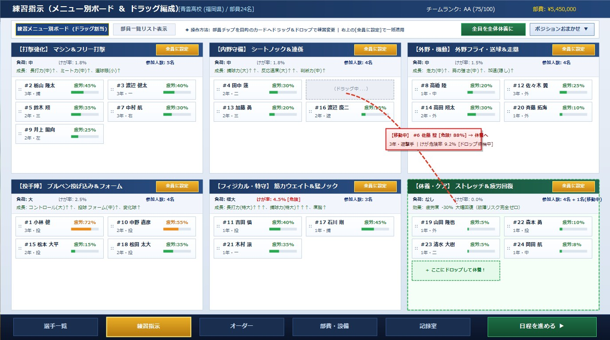

# 練習指示画面 仕様書 (Training Settings Specification)

## 1. 概要とコンセプト
練習指示画面は、チーム全体の育成・強化と選手のコンディション（疲労蓄積・故障予防）をマネジメントする画面である。

従来の一人ひとりプルダウンを設定する煩雑さを排除し、**「練習メニューごとに誰がいるか」が一目で把握できるカンバンボード形式**を採用。
直感的な**ドラッグ＆ドロップによる練習変更**と、ワンタップで全部員を一括適用できる**「全員に設定」機能**により、快適かつ戦略的なチーム育成を実現する。

---

## 2. 画面レイアウト・デザインイメージ

### 2.1 配色・トーン＆マナー
- **ヘッダー/フッター**: 深みのあるネイビーブルー（`#112244`）とゴールドアクセント。他画面（メイン画面、選手一覧、オーダー）と完全統一。
- **ボトムナビゲーション**: 「練習指示」タブがゴールド枠・イエロー発光でアクティブ状態を表示。
- **画面構成（6大メニューグリッドボード）**:
  - 主要な練習カテゴリー（打撃、内野守備、外野機動、投手陣、フィジカル特守、休養ケア）の大型カードを画面全体に整列配置。

---

## 3. 主要機能と操作仕様

### 3.1 練習メニュー別ボード（カンバン方式）
各練習カードには、以下の情報と参加選手のチップが収容される。

| 練習カテゴリー | 負荷 | 基本けが率 | 成長パラメータ / 効果 | 特徴・備考 |
| :--- | :---: | :---: | :--- | :--- |
| **【打撃強化】 マシン＆フリー打撃** | 中 | 1.8% | 長打力(中)↑、ミート力(中)↑、選球眼(小)↑ | 実戦的な打撃力強化 |
| **【内野守備】 シートノック＆連係** | 中 | 1.8% | 捕球力(大)↑↑、反応速度(大)↑↑、判断力(中)↑ | 内野ゴロ・ゲッツー連係 |
| **【外野・機動】 外野フライ＆走塁** | 中 | 1.5% | 走力(中)↑、肩の強さ(中)↑、加速(隠し)↑ | 守備範囲と俊足の強化 |
| **【投手陣】 ブルペン投げ込み＆フォーム** | 大 | 2.5% | コントロール(大)↑↑、投球フォーム(中)↑、変化球↑ | 制球力と球速のベースアップ |
| **【フィジカル・特守】 筋力＆猛ノック** | 極大 | 4.5%[危険] | 長打力(特大)↑↑↑、捕球力(特大)↑↑↑、度胸↑ | 急激な能力向上だが故障リスク大 |
| **【休養・ケア】 ストレッチ＆疲労回復** | なし | 0.0% | **疲労度 -30% 大幅回復**（怪我発生ゼロ） | 疲労抜き・大会直前の調整 |

---

### 3.2 直感的なドラッグ＆ドロップ操作
1. **選手チップの移動**:
   - 各カード内の選手チップ（`背番号 氏名 / ポジション / 疲労度ゲージ`）をマウスで掴み、移動先の練習カードへドラッグ＆ドロップするだけで即座に練習が切り替わる。
2. **疲労警告と休養へのエスコート**:
   - 疲労度80%以上の選手（例: #6 佐藤 駿 88%）はチップが**赤枠・赤背景で強調表示**され、一目で危険であることがわかる。
   - プレイヤーは危険選手をドラッグして「休養・ケア」カード（緑の点線ドロップ枠）へ移動させることで、簡単に故障を予防できる。

---

### 3.3 「全員に設定」＆ クイック一括機能
1. **カードごとの「全員に設定」ボタン**:
   - 各練習カードのヘッダー右上にある `全員に設定` ボタンをクリックすると、**全部員（24名）がその練習メニューへ一斉に移動**する。
   - 例: 大会前日に全員で「マシン＆フリー打撃」を行う、炎天下の練習後に全員で「ストレッチ＆疲労回復」を行う等の運用が1クリックで完了。
2. **上部バーのワンタップボタン**:
   - `全員を全体休養に`: 全員を即座に休養・ケア枠へ移動し、チーム全体の疲労をリセット。
   - `ポジションおまかせ ▼`: ポジション（投・捕・内・外）に応じた適正メニューへ一括自動振り分け。
3. **表示切り替えタブ**:
   - `[練習メニュー別ボード (ドラッグ割当)]`（現在のボードUI）
   - `[部員一覧リスト表示]`（従来の縦スクロール一覧テーブルで全ステータスを詳細確認可能）

---

## 4. 成長計算・性格・ケガ判定システムとの連動

本画面で設定された練習編成は、日程進行エンジン（`executeDaySimulation`）によって日々の成長・疲労計算へ反映されます。
- **10大性格（努力家、熱血漢、冷静、職人、天才肌 等）**: メニューごとに固有の成長率ボーナスが適用されます。
- **疲労度80%以上警告**: 80%を超えると赤枠点滅表示となり、日々のケガ率が急上昇（8.0%）します。
- **ケガの離脱期間**: 軽傷（3〜5日: 70%）、中等度（10〜21日[2〜3週間]: 28%）、重傷（1〜2ヶ月: 2%稀）。

※能力上昇計算式、性格・成長タイプマトリクス、ケガ判定ロジックの詳細は、[選手育成・能力成長＆疲労・ケガ計算システム詳細仕様書（training_and_growth_specification.md）](./training_and_growth_specification.md) を参照。
